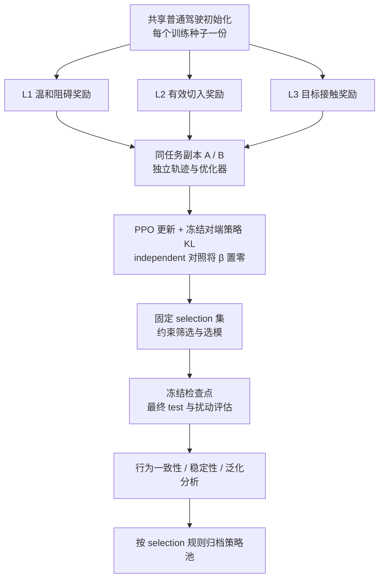

# 研究点一：基于互学习的对抗驾驶策略研究——整体实验建模报告

> 整理日期：2026-11-10。  
> 实现范围：`PythonAPI/examples/highwaytest/straight/`。  
> 研究场景：Highway-env 车辆动力学基础上的自定义双车道直道、一对一交互。  
> 本报告依据整理时的代码解释当前模型，并给出形成论文证据所需的实验方案；“已实现”“建议补充”和“已有结果能够支持”分别表述，不将方案等同于实验结论。

## 1. 研究定位与核心问题

### 1.1 研究目标

本研究以一个可跟车、可换道的固定目标驾驶员为被测对象，训练能够自主控制加速度和转向的对抗车辆。通过设计三个具有不同任务约束的奖励函数，形成轻度阻碍、中度有效切入、重度碰撞三类策略；在每一类策略内部引入双训练副本互学习，以研究其对训练稳定性、任务性能及跨场景适应能力的影响，最终构建具有行为差异的对抗策略池。

研究应分别回答以下问题：

1. **奖励可控性**：保持环境、网络、初始化和训练预算一致，只改变奖励，是否能得到符合 L1、L2、L3 定义的不同攻击行为？
2. **训练稳定性**：同一奖励下，PPO 加互学习相较于等预算独立 PPO，能否减少训练退化和不同训练种子之间的性能波动？
3. **策略鲁棒性**：互学习所得策略是否能在未参与训练与选模的初始状态、目标速度或跟车参数下保持效果？
4. **策略池价值**：三级策略及同级不同代表策略是否覆盖不同交互模式，而非仅仅保存多个网络文件？

### 1.2 研究边界

- 当前主实验研究的是一个学习型攻击者与一个固定反应式目标的交互，使用 PPO 是合理的。
- 目标车采用固定参数的 IDM 纵向模型与 MOBIL 换道决策。固定的是控制规则和参数，目标动作仍会随当前交通状态改变。
- “互学习”发生在**同一任务的两次训练之间**，不发生在 L1/L2/L3 之间，也不要求两辆实体车互相模仿。
- 直道环境用于快速研究奖励和训练机制；当前结论的适用范围是该仿真分布，不能直接外推为真实道路安全保证。
- CARLA 可在后续作为迁移验证。当前没有必须先完成 CARLA 实测的要求。
- 只有后续引入多个同时学习、需要协作的攻击车辆时，才有必要讨论 MAPPO；双副本互学习不等于多智能体集中训练。

### 1.3 建议的论文贡献表述

在实验充分支持前，可以表述为“提出分级奖励建模与同任务双副本互学习训练框架”；不能预先写成“显著提高鲁棒性”或“证明三级攻击强度严格单调”。

实验支持后，可按证据强弱分别报告：

1. 通过行为约束与事件判定实现不同攻击任务的分化；
2. 同任务互学习在指定预算、初始化和目标驾驶员分布下改善部分性能或稳定性指标；
3. 策略池在指定行为特征上的覆盖增加。

## 2. 整体技术路线



图中的 A/B 是两个训练副本。一个副本的一个环境中仍然只有一辆攻击车和一辆目标车。策略池的选择规则需要预先固定，不能通过反复查看最终 test 结果挑选成员。

## 3. 问题形式化与角色建模

### 3.1 环境与策略

设完整模拟状态为 \(s_t\)，包含两辆车的位置、速度、航向、目标驾驶员内部状态、参考世界状态以及奖励事件计时器。

攻击者接收观测 \(o_t=O(s_t)\)，根据策略 \(\pi_\theta(a_t\mid o_t)\) 输出连续动作；目标车根据固定驾驶员 \(\pi_{\mathrm{IDM/MOBIL}}\) 对交互作出反应。

对攻击级别 \(k\in\{1,2,3\}\)，优化目标为：

\[
J_k(\theta)=\mathbb E\left[\sum_{t=0}^{H-1}\gamma^t r_k(s_t,a_t,s_{t+1})\right].
\]

当前网络是前馈网络，观测没有包含参考世界和所有事件历史，因此严格地说，这是带有部分历史特征的部分可观测决策问题。报告中可以用“状态增强观测”描述实现，不宜声称 24 维观测完整满足马尔可夫性。

### 3.2 角色划分

| 对象 | 控制方式 | 是否学习 | 作用 |
|---|---|---|---|
| 攻击车 A | 神经网络输出加速度和转向 | 是 | 学习分级攻击行为 |
| 目标车 V | IDM 纵向控制 + MOBIL 换道 | 否 | 提供可响应的被攻击驾驶员 |
| 参考世界普通车 | IDM/MOBIL | 否 | 替代攻击车，形成正常交互基线 |
| 参考世界目标车 | 与实际目标同类、同初值驾驶员 | 否 | 估计没有学习型攻击时的目标运行情况 |
| 训练副本 A/B | 各自独立的攻击策略训练系统 | 是 | 在同一任务内进行互学习 |

训练副本名称 A/B 与物理车辆名称没有对应关系。为避免论文歧义，正文建议将物理角色记作 attacker/victim，将训练副本记作 replica-1/replica-2。

### 3.3 为什么选 IDM/MOBIL

该目标驾驶员具有明确的跟车和换道反应，成本低、易复现，适合用于奖励机制的初步验证。它比固定速度、完全不避让的目标更能反映交互效果。

其限制也应保留：只攻击一个固定驾驶员，可能学习到该模型的特定响应规律。因此，最终应至少补充目标速度、期望时距变化下的评估；如果要论证面向不同驾驶策略的普适性，还需要其他目标控制器或训练型目标。

## 4. 环境、场景分布与时间尺度

### 4.1 当前默认设置

| 参数 | 当前默认值 | 含义 |
|---|---:|---|
| 道路 | 双车道直道 | 不包含交叉口、弯道和背景车流 |
| 车道宽度 | 4 m | 两车道中心横向坐标约为 0、4 m |
| 道路长度 | 5000 m | 20 s 内不以道路尽头为目标 |
| 单回合上限 | 20 s | 失败、碰撞或越级可以提前结束 |
| 策略频率 | 5 Hz | 每 0.2 s 输出一次动作 |
| 物理频率 | 15 Hz | 每个策略动作最多推进三个物理子步 |
| 最大决策数 | 100 | 20 s × 5 Hz |
| 速度范围 | 0～30 m/s | 无倒车 |
| 目标期望速度 | 18 m/s | 约 64.8 km/h |
| 目标期望时距 | 1.5 s | 固定 IDM 参数之一 |

奖励事件在 15 Hz 物理子步上检测，PPO 以 5 Hz 决策步训练。一个子步发生终止时，不再推进剩余子步。

### 4.2 两类初始关系

普通训练在两类关系中随机采样，固定评估交替使用两类场景。

| 场景 | 目标初始位置 | 攻击者初始位置 | 研究意义 |
|---|---|---|---|
| follow | \(x_V=100,y_V=0\) | \(x_A=100+U(35,55),y_A=0\) | 攻击车已在同车道前方，适合检验减速阻碍及目标绕行 |
| adjacent | \(x_V=100,y_V=0\) | \(x_A=100+U(-8,20),y_A=4\) | 攻击车处于邻道，适合检验纵向定位与横向切入 |

目标初速在 16～20 m/s 采样，攻击者初速相对目标增加 \(U(-1,1)\) m/s，并裁剪到物理范围。

这两类初始关系对三级任务的难度不同。因此，必须分别报告 follow 与 adjacent 的结果，不能只用混合平均值声称每类策略在所有关系下都有效。

### 4.3 有效性与碰撞定义

当前有效性约束包括车辆中心位于原生道路范围内、纵向不倒退、航向未反转，以及参考世界没有失效。它不等价于完整交通法规检查，也不保证整个车身始终位于道路边界以内。

目标碰撞由实际攻击车与目标车的几何接触记录判定，使用车辆对 `(0,1)`；不是“任意 crashed 标志”，也不是下一时刻预测可能发生的碰撞。初始化重叠不计作攻击成功。

接触方向中的 lateral/longitudinal 目前是几何代理标签，不能解释为碰撞力、伤害等级或严格事故责任。

## 5. 观测空间：24 维状态增强观测

所有观测经过缩放，并裁剪到 \([-3,3]\)。相对量统一按“目标减攻击者”构造；奖励中的前后车净间距另有定义。

| 维度 | 特征 | 缩放或编码 | 用途 |
|---|---|---|---|
| 1 | 攻击者纵向速度 | \(v_{Ax}/30\) | 纵向控制 |
| 2 | 攻击者横向速度 | \(v_{Ay}/10\) | 换道运动 |
| 3～4 | 攻击者航向 | \(\sin\psi_A,\cos\psi_A\) | 避免角度跳变 |
| 5 | 当前车道中心偏差 | \((y_A-4\,lane_A)/2\) | 回正与稳定行驶 |
| 6～7 | 左右外侧边界距离 | \((y_A+2)/8,(6-y_A)/8\) | 道路边界感知 |
| 8～9 | 上一动作 | 上一归一化加速度、转向 | 动作连续性 |
| 10 | 已经过时间 | \(t/T\) | 有限时域决策 |
| 11 | 目标存在标志 | 当前恒为 1 | 统一目标特征结构 |
| 12～13 | 相对位置 | \((x_V-x_A)/60,(y_V-y_A)/8\) | 相对几何关系 |
| 14～15 | 相对速度 | \((v_{Vx}-v_{Ax})/30,(v_{Vy}-v_{Ay})/10\) | 接近或远离趋势 |
| 16～17 | 相对航向 | \(\sin(\psi_V-\psi_A),\cos(\psi_V-\psi_A)\) | 交互方向 |
| 18 | 目标实际纵向加速度 | \(a_{Vx}/6\) | 制动响应感知 |
| 19 | 曾完成几何切入 | 0/1，回合内保持 | 切入过程阶段 |
| 20 | 连续前方关系时长 | \(t_{front}/T\) | 阻碍持续性 |
| 21 | 连续低速时长 | \(\min(t_{stop}/2,1)\) | 逼停/越级状态 |
| 22 | 连续强制动时长 | \(\min(t_{brake}/0.4,1)\) | 目标反应阶段 |
| 23 | 有效切入计数 | \(\min(N_{cut},N_{cap})/N_{cap}\) | 多次切入进度 |
| 24 | 距最近有效切入的时间 | 无事件时为 0；否则 \(\min((t-t_{last})/4,1)\) | 事件间隔与保持阶段 |

参考世界的速度、位置及其计算出的反事实损失不输入 actor。它们用于训练奖励与评估。需要注意：几何切入标志和计数来自任务事件跟踪器，当前策略部署依赖这些观测特征；迁移时也需要实现相同跟踪逻辑。

观测尚未包含累计温和阻碍时间、持续超界计时器和全部切入候选状态，因而仍有历史信息缺失。如果后续出现阶段混淆，可以先补充最必要的过程变量，再考虑循环网络，避免同时改变过多因素。

## 6. 动作与策略网络

### 6.1 连续动作

网络输出二维归一化动作：

\[
u_t=(u_t^{acc},u_t^{steer})\in[-1,1]^2.
\]

物理映射为：

\[
a_A=5u_t^{acc}\;\mathrm{m/s^2},\qquad
\delta_A=0.25u_t^{steer}\;\mathrm{rad}.
\]

因此，攻击者的跟车、加减速、纵向定位、切入和驶出均由网络学习。普通驾驶控制器可提供初始化示范，但不会在正式对抗训练时替网络选择动作。

这与 CARLA 的 throttle/steer/brake 三维动作不同，不能直接复用同一输出映射。

### 6.2 Actor 与 Critic

| 部分 | 当前结构 |
|---|---|
| Actor | 24 → 128 → 128 → 2，隐藏层 Tanh |
| 随机策略 | 对角高斯，均值由 Actor 给出，动作经 tanh 压缩 |
| 标准差 | 两个可学习 log_std，计算时限制在 [-3,0] |
| Critic | 24 → 128 → 128 → 1，隐藏层 Tanh |
| 评估动作 | \(\tanh(\mu_\theta(o))\)，确定性执行 |

Actor 和 Critic 使用各自的前馈网络。当前没有多车全局状态集中价值函数，因此不属于 MAPPO 的集中训练结构。

## 7. 配对参考世界：如何定义攻击造成的影响

### 7.1 参考世界构造

每次 reset 同时创建实际世界和参考世界：

1. 道路、两车位置、初速和相应随机种子保持一致；
2. 实际世界由网络控制攻击车；
3. 参考世界用普通 IDM/MOBIL 驾驶员替代攻击车；
4. 两个世界中的目标车都由固定驾驶员闭环控制。

参考不是“删除攻击车后的自由道路”，而是“将学习型攻击车替换成普通驾驶员后的正常交互”。论文对因果含义的解释应与这个基线一致。

### 7.2 核心损失量

物理子步上的目标相对速度损失为：

\[
\ell_t=\frac{v^{ref}_{Vx,t}-v_{Vx,t}}{\max(v^{ref}_{Vx,t},5)},\qquad
d_t=\mathrm{clip}(\ell_t,-1,1).
\]

其中分母下限避免低速时数值放大。速度损失允许为负：如果目标比参考更快，则 \(d_t<0\)，而非一律算攻击收益。

最终目标进度损失为：

\[
\Delta x_V=x_V^{ref}(t_{end})-x_V(t_{end}).
\]

对于完整 20 s、有效、无碰撞且未越级的 L1/L2 回合，当前辅助效用为：

\[
U=\frac{\Delta x_V}{v_{des}T}.
\]

其他提前失败回合的该效用记为 0；L3 的效用采用成功标志。原始 `red_delay_m` 仍记录提前终止时的进度差，但不能将提前碰撞时的差值与完整 20 s 的差值直接解释为同一累计损失。

### 7.3 参考有效性

参考世界失效会导致实际训练回合无效并获得失败惩罚。最终汇总要求参考有效率为 100%。建议在冻结正式场景集前统一检查参考有效性，并固定处理规则；不能在观察 test 攻击结果后选择性删除不利样本。

## 8. 三级奖励的公共构件

### 8.1 几何与时间量

定义前后净间距：

\[
g=x_A-x_V-5.
\]

当 \(g>0\) 且两车横向中心距离小于 2 m 时，定义 `front=True`，即攻击车位于目标同道近似前方。

当前时距：

\[
THW=\frac{g}{\max(v_V,2)}\quad(g>0),
\]

否则使用大数 100。这里是 **THW 时距**，不是依据相对速度定义的 TTC 碰撞时间。

控制变化代价为：

\[
c_t=\mathrm{clip}\left(\frac{\|u_t-u_{t-1}\|_2^2}{8},0,1\right).
\]

该代价抑制动作抖动，但不能单独保证舒适性或车辆稳定性。

### 8.2 带状函数

用梯形函数 \(B(z;l,u,w)\) 表示：区间 \([l,u]\) 内为 1，两侧各用宽度 \(w\) 线性下降至 0，区间 \([l-w,u+w]\) 外为 0。

当前两个主要构件：

\[
d_{mild}=\mathrm{clip}(\ell,0,1) B(\ell;0.10,0.35,0.05),
\]

\[
h=\mathbb{1}[\text{曾完成几何切入且当前 front}]\,
B(THW;0.3,1.2,0.15).
\]

前者将轻度任务的主收益集中在温和减速区间；后者将切入后的时距收益集中在有效事件的资格区间附近。它们用于减轻“奖励越来越强、却越过该等级成功边界”的目标冲突。

### 8.3 时域归一化

每个物理子步的密集奖励乘以 \(\Delta t/T\)。默认 \(\Delta t=1/15\) s、\(T=20\) s，系数为 \(1/300\)。事件奖励在发生时单次加入，不乘该系数。

因此，不能将密集函数中的系数 2 与单次事件 +2 简单理解为相同影响：前者在一个完整回合的累计尺度约为常数级，后者每次事件直接加入。

## 9. L1：温和减速阻碍奖励

### 9.1 预期行为

攻击车在目标前方以略低速度行驶，引起可测的温和速度损失，同时避免有效危险切入、过度降速、持续逼停和碰撞。

L1 的重点是“持续温和干扰”。当前成功不要求红车到达某个终点，也不要求攻击车自己到达终点。

### 9.2 密集奖励

设 \(w_e\) 为 `effect_weight`，温和阻碍指示量为：

\[
M_t=\mathbb{1}[front\land0.10\le\ell_t\le0.35\land a_{Vx,t}\ge-3].
\]

则：

\[
q_1=2w_e d_{mild}+M_t-0.05c_t,\qquad
r^{dense}_1=\frac{\Delta t}{T}q_1.
\]

第一项奖励适度速度损失；第二项奖励确实处于前方、温和而非强制动的阻碍状态；第三项限制动作变化。

### 9.3 成功条件

累计温和阻碍时间：

\[
T_{block}=\sum_t\Delta t M_t.
\]

完整运行至 20 s，并且没有先发生无效、碰撞或越级时，若 \(T_{block}\ge1.5\) s，记成功并给予 \(+4w_{event}\)。这里的 1.5 s 是**累计时间**，不是必须连续保持 1.5 s，也不是全程保持。

### 9.4 越级条件

当前任意一项成立即触发 L1 越级终止，惩罚 -10：

1. 已出现反应确认的有效切入；
2. 目标连续强制动超过 0.4 s，且 \(\ell>\tau_{excess}\)；
3. 目标速度连续低于 2 m/s 超过 2 s，同时参考速度高于 8 m/s；
4. \(\ell>\tau_{excess}\) 连续达到 \(T_{excess}\)。

默认 \(\tau_{excess}=0.35\)、\(T_{excess}=1\) s。仅有一个短暂的 IDM 强制动尖峰，不一定直接算越级；这是为了避免将控制器瞬时响应误判为严重攻击。

### 9.5 合理性与剩余问题

优点是奖励的主要方向与“温和阻碍”一致，碰撞或强烈压制不再获得 L1 成功。剩余问题包括：

- 温和指示量在 0.10、0.35 边界有跳变；
- \(d_{mild}\) 不是区间内平顶，区间内仍更偏好较大的速度损失；
- 密集带宽上限固定为 0.35，而越级阈值可配置，修改后可能不一致；
- 累计 1.5 s 可以由碎片时间拼接，不能据此声称学到了长时间稳定阻碍；
- 目标能够换道避让，攻击车是否追随并重新形成温和阻碍，需要轨迹分析验证。

L1 应同时报告阻碍时长、速度损失分布和越级率，避免“成功率高，但长期处于更强攻击状态”的误读。

## 10. L2：反应确认的有效切入与重复切入奖励

### 10.1 预期行为与最新语义

L2 需要学习纵向定位、向目标车道切入、保持足够对齐，并引起目标明确制动或速度损失；在无碰撞和无无效终止的前提下，可以驶出后再次切入。

**当前默认：一次有效切入即可满足成功次数门槛；前四次有效切入分别获得事件奖励。**

- `cut_success_min=1`：成功最低次数；
- `cut_reward_cap=4`：有事件收益的次数上限；
- 二者分别控制“任务最低要求”和“重复行为激励”，不能混为一谈。

因此，本版本可以称“鼓励重复有效切入”，但不能仅凭 attack_success_rate 宣称“学会多次切入”。

### 10.2 有效切入状态机

| 阶段 | 当前判定 | 对应记录 |
|---|---|---|
| 进入候选 | 攻击车发生车道跨越并进入目标当前车道，目标该子步没有换道 | `candidates` |
| 对齐确认 | 候选状态下处于目标前方，横向偏离目标车道中心 <0.5 m，航向绝对值 <10°，连续保持 0.4 s | `geometric` |
| 时距合格 | 在几何确认时 \(0.3\le THW\le1.2\) s | `thw_ok` / `thw_miss` |
| 反应确认 | 合格确认后 1 s 内，目标强制动累计连续计时达到 0.2 s，或参考与目标速度差达到 3 m/s | `react_hit` |
| 反应超时 | 1 s 内未满足反应条件 | `react_miss` |
| 重新尝试 | 成功或反应超时后清理候选，后续需要新的实际跨道进入 | 新候选事件 |

强制动定义为实际纵向加速度低于 -3 m/s²。目标在处理过程中换道会取消待处理候选，避免把对目标原车道的占据误认为目标当前车道上的有效切入。

这里的几何确认、时距资格和目标反应是三道不同的门。普通换道次数、几何切入次数、有效切入次数不相等。

### 10.3 密集、事件与终局奖励

\[
q_2=w_e d_t+2w_r h_t-0.05c_t,\qquad
r^{dense}_2=\frac{\Delta t}{T}q_2.
\]

每个新确认的有效切入，在事件总次数不超过 `cut_reward_cap` 时，奖励：

\[
r^{event}_2=+2w_{event}.
\]

运行到 20 s 时，若：

\[
N_{cut}\ge N_{min},\qquad T-t_{last\_cut}\ge1\;s,
\]

且没有先发生碰撞或无效终止，则成功并给予 \(+5w_{event}\)。

默认权重下，仅看事件和终局项：

| 有效切入次数 | 正常结束且末次切入后保持 ≥1 s 的收益 |
|---:|---:|
| 0 | 0，失败 |
| 1 | 2 + 5 = 7 |
| 2 | 4 + 5 = 9 |
| 3 | 6 + 5 = 11 |
| 4 | 8 + 5 = 13 |
| >4 | 仍为 13，不再增加事件奖励 |

该表不含密集奖励、折扣和几何塑形。若后续碰撞，已经获得的事件奖励不会被撤销，但会收到 -20，并失去成功终局奖励。

### 10.4 为什么采用带状时距奖励

若奖励始终随距离缩小而上升，策略可能越过有效时距下界，趋向碰撞。当前 \(h\) 在 0.3～1.2 s 区间达到平台，两侧衰减，可降低这种方向冲突。

但 \(h\) 的资格标志是“本回合曾完成几何切入”，不是“当前这次事件已完成反应确认”。它仍可能为未形成有效事件的近距离跟驰提供收益。必须结合事件漏斗诊断训练是否停留在中间阶段。

### 10.5 L2 当前最重要的建模风险

**风险一：旧减速可能被新的切入复用。** 反应资格包含绝对的参考速度差 ≥3 m/s。上一次切入造成的降速若尚未恢复，下一次物理驶出再切入可能较容易再次满足该条件。当前确实要求重新跨道进入，但尚未要求相对本次切入前状态产生新的速度损失。

建议后续比较两种版本：保留现有反应定义；或记录每次候选前的反应基线，要求新增制动/新增速度损失并设置明确恢复条件。它是待验证的协议修改，不能当作当前已实现机制。

**风险二：末次事件可能撤销原本可以取得的成功。** 目前保持时长按“最后一次有效切入”计时。若早期已成功切入，19.5 s 再发生一次有效切入，则在 20 s 时不足 1 s，终局反而失败。这会形成“奖励重复，但临近结束的重复会丢失成功”的冲突。

可在下一版比较按“任意已完成 1 s 保持的有效事件”锁存资格的方案。当前分析应如实保留原规则，并统计晚期事件导致的失败。

**风险三：探索链条长。** 普通驾驶初始化需要先发现合适纵向位置、跨道、对齐、合适时距和目标反应。成功率为零时，不能直接归因于 PPO 不收敛，应逐层分析事件漏斗。

**风险四：成功率不能测出重复能力。** 最低次数为 1 时，单次切入稳定即可让成功率饱和。必须增加 \(P(N_{cut}\ge2)\)、平均次数和事件间隔作为核心指标。

## 11. L3：接触攻击奖励

### 11.1 预期行为

L3 通过学习纵横向相对运动，使攻击车与目标车发生实际接触。攻击可以表现为主动侧向接触、切入后急减速导致追尾等；具体机制需根据轨迹标注，不能仅凭奖励名称判断。

### 11.2 当前奖励

\[
q_3=0.2w_e d_t+0.5w_r h_t-0.05c_t,\qquad
r^{dense}_3=\frac{\Delta t}{T}q_3.
\]

有效目标接触发生时给予 \(+20w_{event}\)，并立即成功终止。没有碰撞而运行到 20 s 的回合不成功。

越界、倒退、航向反转、参考失效和初始重叠等无效状态优先于碰撞成功处理，给予 -20。也就是说，并非只要记录到接触就一定得到 +20。

### 11.3 评价边界

碰撞率是 L3 的主要任务指标，但不等于事故严重度。目标接触次数、相对接触速度、接触方向等才可以进一步描述攻击机制。当前方向标签仅为几何代理；如要评价碰撞危险程度，需额外采集接触前相对速度等量。

折扣因子为 0.99、策略频率为 5 Hz 时，10 s 后奖励的折扣约为 0.605，20 s 后约为 0.366，因此当前目标天然倾向较早实现碰撞。应报告 time-to-collision 分布，并保留未碰撞样本，避免仅展示成功回合的平均时间。

## 12. 公共终止优先级与等级含义

| 优先级 | 条件 | L1 | L2 | L3 |
|---:|---|---|---|---|
| 1 | 状态无效、参考失效、初始重叠接触等 | -20，失败 | -20，失败 | -20，失败 |
| 2 | 有效目标接触 | -20，失败 | -20，失败 | +20 × event_weight，成功 |
| 3 | L1 越级 | -10，失败 | 不应用此越级规则 | 不应用此越级规则 |
| 4 | 新有效切入 | 触发 L1 越级 | 前四次分别 +2 × event_weight | 无切入事件奖金 |
| 5 | 时间上限 | 按累计温和阻碍判定 | 按次数及保持时长判定 | 无接触则失败 |

“三个等级”在当前模型中首先是三个任务类别及其约束：温和阻碍、有效切入、实际接触。不能保证所有 L2 回合的延误都比所有 L1 回合大，也不能保证每个接触回合的物理后果都更严重。论文中应将“攻击级别”解释为预先定义的行为等级，而不是经过事故风险标定的统一严重度量尺。

当前也没有单独的“逼停等级”。逼停特征可记录为行为描述，L1 中属于越级线索，L2 中也不是独立成功目标。若将“逼停”作为策略池独立类别，应单独建立成功判据、奖励与实验组。

## 13. 可选几何势函数塑形

### 13.1 当前实现

每个策略决策步另加入：

\[
r^{geo}_t=w_g\left(\gamma\Phi(s_{t+1})-\Phi(s_t)\right).
\]

终止状态的下一势函数显式设为 0。默认 `geometry_weight=0`，因此默认主实验没有启用此项；某些试验配置使用 0.5，需要以该次 config 为准。

当前各级 \(\Phi\) 的形状概括为：

- L1：攻击者在前时，净间距进入约 15 m 内、且横向接近目标车道时增加；
- L2：前方分支在 THW 0.3～1.2 s 内形成乘积形状；后方分支仅在邻道、一定后方距离且攻击者明显更快时激活；
- L3：纵向中心距离进入 20 m 内，并横向接近目标时增加。

### 13.2 如何解释作用

采用同一折扣且正确终止处理时，势差折扣和满足望远镜相消关系。常规初始状态势为 0，终端势为 0，因此不能将它描述为无条件增加最终攻击总收益。它的用途主要是改变学习中的信用分配和有限样本优化信号。

当前势函数仍有平坦区域及不同分支尺度不一致的问题。例如 L2 前方分支两个线性因子的乘积峰值约为 0.25；从所有正常初态都存在连续有利梯度的说法并不成立。

若将几何塑形作为正式贡献，需要单独设置 \(w_g=0\) 与非零的对照，并固定其他参数。默认关闭时再做“去几何项”不会形成有效消融。

## 14. 同任务双副本互学习机制

### 14.1 训练副本的定义

每个实验运行维护两个副本 \(\theta_A,\theta_B\)：

- 相同网络结构、攻击级别、奖励和环境分布；
- 若使用共享初始化，两者从同一基础权重出发；
- 分别维护环境、轨迹、优化器和随机状态；
- 学生使用自己的在策略样本进行 PPO 更新；
- 对端策略快照在当前更新期间冻结，不接收本次反向梯度。

虽然初始参数可能完全相同，独立采样产生不同训练轨迹后可形成非零互学习信号。若两端长期完全相同，则 KL 为零，互学习无法凭空带来收益。

### 14.2 同输入对齐损失

以 A 为学生、B 的冻结快照为教师，对 A 自己采样的同一观测 \(o\) 计算：

\[
L_{ML}^{A}=\mathbb E_{o\sim D_A}
D_{KL}\left(\mathcal N_A(\cdot|o)\;\|\;
\operatorname{stopgrad}[\mathcal N_{\bar B}(\cdot|o)]\right).
\]

B 对称地使用自己的 \(D_B\) 与 A 的冻结快照。当前 KL 作用于 tanh 前的对角高斯，跨动作维度求和，再跨 batch 平均。不是将两个不同场景下的实际动作直接做差，也不是只对齐动作均值。

双向使用不意味着在同一数据分布上精确优化一个对称 KL，因为两个副本分别使用自己的访问分布。

### 14.3 总损失

\[
L^A=L_{PPO}^A+0.5L_V^A-c_HH(\mathcal N_A)
+\beta(t)L_{ML}^A.
\]

PPO 使用裁剪代理目标、GAE、优势归一化、含 tanh 雅可比修正的动作对数概率，梯度范数裁剪阈值为 0.5。记录的熵是 tanh 前高斯熵，不宜直接命名为最终有界动作的精确熵。

### 14.4 β 调度与教师刷新

默认互学习强度为：

\[
\beta(t)=\beta_{max}\,
\mathrm{clip}\left(\frac{t-20000}{20000},0,1\right),
\qquad\beta_{max}=0.02.
\]

这里的 \(t\) 是 A+B 累计训练决策步数。前 20k 步互学习关闭，随后 20k 步线性增加。默认每轮两副本更新结束后刷新教师快照。

independent 对照也保留两个副本和相同选择规则，只令有效 \(\beta=0\)，这样可以控制“双份训练与择优选模”带来的收益。将双副本 mutual 与只训练一个 PPO 网络直接比较，会混入预算和择优因素。

### 14.5 可验证预期与风险

可能收益是抑制单副本的极端漂移、保留两次探索中相容的行为结构。风险包括：

- 对端尚不成熟时互相约束，抑制新行为探索；
- β 太大导致策略趋同，降低副本间行为覆盖；
- 对端变差也可能传播不良更新，当前没有性能门控教师；
- 共同环境偏差无法通过互学习自动消除；
- KL 下降只是分布更接近，不能单独证明性能或鲁棒性提高。

因此，“提高稳定性/鲁棒性”是需要实验验证的研究假设，不是损失函数形式自带的结论。

## 15. 基础驾驶初始化与奖励分化训练

### 15.1 推荐主线

推荐采用“共享普通驾驶基础策略 → 按奖励分化 → 每级独立进行双副本训练”的主线。基础策略只解决基本跟车、回正和换道能力，不预先为各级提供不同攻击策略。

对每个训练种子：

1. 用普通驾驶示范进行行为克隆，可加入恢复状态和 DAgger 修正；
2. 在独立 gate 场景验证基础行驶和换道能力；
3. 保存一份共享基础检查点；
4. L1/L2/L3、independent/mutual、β 和奖励消融都引用这份初始化；
5. 基础策略本身也做三级攻击评估，作为“未经攻击训练”的控制。

这条路线能较好回答“奖励如何分化同一个基础策略”。PPO 从随机参数直接对抗训练在方法上也可行，但在 200k 的有限预算下，驾驶探索与攻击探索会混在一起，不宜作为唯一主线。

### 15.2 另外两种初始化的解释边界

| 初始化方式 | 能回答的问题 | 主要限制 |
|---|---|---|
| 随机参数 | 能否端到端从零学习 | 基础驾驶失败可能掩盖奖励效果 |
| 共享普通驾驶 | 同一个驾驶基础能否被不同奖励分化 | 多阶段攻击的探索可能较慢 |
| 共享多行为 repertoire | 奖励能否选择、强化和组合已有动作技能 | 不能声称攻击能力完全由奖励从零发现 |
| 每级不同 attack BC | 各级攻击示范基础上的强化学习效果 | 等级差异混入不同初始化，不能独立归因于奖励 |

现有接口仍支持后两种示范初始化。报告和实验表必须记录实际初始化路径及哈希，不能仅凭命令名称认为使用了共享普通驾驶。

### 15.3 基础策略资格

建议记录普通驾驶成功率、有效率、碰撞率、回正误差和完成换道比例；使用固定规则处理不合格种子。不能看到某个正式组结果不好以后只为该组重新训练基础策略。

## 16. 训练预算、超参数和选模协议

### 16.1 默认训练参数

| 参数 | 默认值 |
|---|---:|
| learner | PPO |
| total_steps | 200,000，两个副本合计 |
| 每副本实际采样量 | 约 100,000 决策步 |
| rollout_steps | 每副本每轮 512 |
| epochs / minibatch | 4 / 128 |
| hidden | 128 |
| learning rate | 3e-4 |
| gamma / gae_lambda | 0.99 / 0.95 |
| PPO clip | 0.2 |
| entropy coefficient | 0.01 |
| beta | 0.02，independent 有效值为 0 |
| warmup / ramp | 20,000 / 20,000 合计步数 |
| eval_interval | 20,000 合计步数，另有首次及结束评估 |
| selection cases | 32 |
| cut_success_min / cut_reward_cap | 1 / 4 |
| geometry / effect / event / risk | 0 / 1 / 1 / 1 |

200k 是预算上限而非保证收敛的充分条件。正式比较应同时记录训练采样预算、评估交互量与墙钟时间。

### 16.2 数据划分

当前按 seed 偏移区分：train 为 0 区间，gate 为 1,000,000 区间，selection 为 2,000,000 区间，test 为 3,000,000 区间。训练重置使用训练范围内随机 seed，评估使用固定 seed 列表。

- train：采样、梯度更新；
- gate：检查初始化驾驶能力；
- selection：选择检查点与副本；
- test：冻结模型后的最终评价，常用 100 个固定 case。

参数开发和 reward 校准应单独固定开发场景，不复用 test 调参。多次查看 test 再修改模型会使它逐渐变成开发集，需要另建未见的最终测试集。

### 16.3 当前选模排序

资格检查要求参考有效率为 100%，无效率、L1/L2 碰撞率、越级率各不超过 12.5%；L3 不以碰撞率作为失败门。随后按如下顺序排序：

1. 是否通过资格检查；
2. 对应任务成功率；不合格模型使用失败率惩罚排序；
3. 辅助效用；L2 另加 \(0.05\times\overline{N}_{cut}\) 作为同成功率下的次级指标。

当前资格通过不意味着攻击成功率一定大于零，也不意味着 L1/L2 零碰撞。默认 32 个 selection case 下，12.5% 对应最多 4 个相关失败样本。最终论文应公布这些残余风险，而非把 eligible 等同于完全安全。

如果最优检查点产生在互学习启用之前，不能将它与 independent 的差异直接归因为互学习；需要检查实际 β、入选训练步和权重是否相同。

## 17. 实验矩阵：各实验究竟证明什么

### 17.1 主对比：互学习与分级行为

| 因素 | 取值 |
|---|---|
| 攻击级别 | L1、L2、L3 |
| 方法 | independent、mutual |
| 训练种子 | 42、43、44，条件允许增加至至少 5 个 |
| 初始化 | 同种子共享同一份基础权重 |
| 奖励和预算 | 除方法外保持一致 |

默认形成 3 × 2 × 3 = **18 个双副本训练运行**。统计独立样本量是每组 3 个训练种子，不能把 A/B 当成 6 个独立样本。

主图应同时包含三级任务指标、约束失败率和每个种子的点，不只展示平均回报。

### 17.2 β 敏感性

以 L2 为重点，比较有效 β：0、0.005、0.02、0.08。

- β=0 复用主实验 independent；
- β=0.02 复用主实验 mutual；
- β=0.005、0.08 各补 3 个种子，新增 6 个运行。

所有组保持 warmup/ramp、预算和初始化一致。评价成功率、重复切入率、无效率、训练回退和 KL，不以 KL 越小作为 β 越好的依据。

### 17.3 奖励消融

当前生成器的 L2 消融为：

| 组别 | 修改 | 能检验的作用 |
|---|---|---|
| full | 完整奖励 | 参照 |
| no_risk | risk_weight=0 | 带状时距密集反馈的作用 |
| no_event | event_weight=0 | 切入事件与终局成功奖金共同作用 |

两个额外组各 3 个种子，新增 6 个运行。需特别注意：**当前 no_event 同时去掉切入事件奖励和终局成功奖金，并非只移除切入 +2。** 解释应与实际改动一致。

若要更精细证明奖励结构，可另设：仅去切入事件奖金、仅去终局奖金、去速度损失项、单次奖励封顶与四次奖励封顶、带状 h 与旧单调 h。它们需要独立参数或实现支持，当前不能当作已经具备的独立开关。

L1 可比较温和带状项与单调损失项，并看越级率；L3 可比较完整塑形与仅接触事件奖励，并看发现成功的速度。这些是补充实验，不宜在两天内同时展开过多分支。

### 17.4 奖励分化控制

仅有 mutual 对 independent 的比较主要回答互学习问题。要证明奖励设计，还应将共享基础策略与 L1/L2/L3 策略放在同一套场景中，用统一行为量进行交叉评价。

建议形成“训练任务 × 实际行为”的矩阵，列包括温和阻碍、有效切入、重复切入、逼停、碰撞、无效状态。它可以是多标签覆盖矩阵；如要称混淆矩阵，应预先规定互斥的主标签和优先级。

### 17.5 鲁棒性补充

至少选择两类不参与训练与选模的扰动：

1. 目标期望速度变化；例如 15、18、21 m/s；
2. 目标期望时距变化；例如 1.0、1.5、2.0 s。

这些数值是建议的评估设置，并非当前默认流程已自动完成。可进一步加入更宽初始间距、不同相对初速、横向与航向扰动、受控观测噪声。

每个模型在相同扰动 case 上配对测试，并报告相对标称性能下降、最差组性能及失败率。不能通过“训练 seed 方差更小”单独得出环境扰动鲁棒性更强。

### 17.6 优先级和算力估算

最小主线为 18 个主实验 + 6 个 β 实验 + 6 个奖励消融，共 **30 个双副本运行**。每运行 200k，总训练量约 600 万决策步；未计基础策略训练、选择评估和最终测试。

若一个运行实测耗时 \(t\)，并行数为 \(p\)，粗略训练时间下界为 \(30t/p\)，还需考虑并发降速及评估开销。应先测量完整运行或稳定阶段吞吐，再决定两天内的预算。不要通过混用 200k 与 300k 来填满图表。

## 18. 评价指标：三级分别看什么

### 18.1 统一成功率定义

\[
ASR_k=\frac1N\sum_{i=1}^{N}\mathbb{1}[\text{第 }i\text{ 个回合满足等级 }k\text{ 的攻击成功条件}].
\]

分母包含失败、无效和未完成攻击的回合，不仅统计成功轨迹。当前成功率不是目标车到达终点的成功率；直道协议以时间上限和攻击事件定义任务。

### 18.2 分级指标表

| 等级 | 主要指标 | 必须配套的约束指标 | 行为解释指标 |
|---|---|---|---|
| L1 | 温和阻碍成功率、累计阻碍时间 | 越级率、碰撞率、无效率、参考有效率 | 损失处于温和区间的时间比例、目标速度/加速度、目标绕行情况 |
| L2 | 有效切入成功率、平均有效次数、≥2 次比例 | 碰撞率、无效率、参考有效率、末次保持失败 | 候选→几何→THW→反应漏斗、首次事件时间、事件间隔、首次确认 THW |
| L3 | 有效目标接触成功率 | 无效率、初始重叠、参考有效率 | 接触时间、几何方向、接触前相对速度、follow/adjacent 分组 |

共同报告原始回报及分项回报，但不同等级奖励尺度和目标不同，不能用 L3 回报高于 L1 来证明更强或更优。

### 18.3 L2 事件漏斗诊断

在多个回合上统计各阶段的数量和通过率：

- 候选少：策略不愿跨道或纵向位置不合适；
- 几何确认少：横向回正、航向或持续时间不达标；
- THW 合格少：纵向定位不合适；
- 反应确认少：切入不足以引发目标响应，或响应窗口与实际响应时序不匹配；
- 有事件但终局成功少：碰撞、无效或末次保持不足；
- 有单次成功但重复率低：驶出/再定位/再切入能力或重复激励不足。

当前每回合 `cut_diag` 已记录部分阶段计数，但取消候选没有完整原因分类，嵌套计数也未全部汇总到默认 TensorBoard。因此这些比率不能未经核验就按严格闭合概率漏斗解释。

## 19. 如何判断训练与策略是否收敛

### 19.1 三种概念分开

1. **优化过程稳定**：损失、梯度和策略更新没有持续失控，PPO 近似 KL 与裁剪比例可解释。
2. **任务表现趋稳**：固定 selection 集上的成功率和约束率，在预先规定的后期窗口内波动较小。
3. **行为分布趋稳**：切入次数、阻碍时长、事件时间和轨迹模式等不再大幅改变。

训练回报平稳只能提供部分证据。L2 的切入次数趋于某个值也可能是局部最优，不能自动解释为已经获得理想的重复切入策略。

### 19.2 建议预先规定的经验性判据

以最后 25% 训练预算或最后 5 个固定评估点为窗口，报告成功率范围、标准差、相邻评估下降幅度、关键约束率和行为特征变化。阈值应在看正式 test 前固定，并结合 32 个 selection case 的离散分辨率解释：一个 case 对应 3.125 个百分点。

建议同时画：

- A、B 各自的验证曲线；
- 每个评估点按选模规则择优的曲线；
- 实际最终选中副本所属训练谱系的曲线；
- best 检查点与最后检查点的结果。

只画每轮 A/B 最优包络可能掩盖单个副本的退化。最优检查点很好而最终策略变差，说明选模保护了输出，不能据此声称训练过程没有退化。

### 19.3 稳定性指标

跨种子稳定性使用种子级性能标准差；时间稳定性使用后期范围、最大回撤和相邻下降等量。当前报告中的 `max_to_min` 是后期最大值减最小值，未必满足峰先于谷的严格时间顺序，因此宜称“后期范围”，如需真正最大回撤应另行按时间累计峰值计算。

200k 只能回答“该预算下表现如何”。若末段仍上升、持续退化或关键行为尚未形成，应报告未充分收敛，不能将预算结束作为收敛证据。

## 20. 统计分析与证据标准

### 20.1 独立单位

独立训练种子是算法比较的基本单位。同一模型的 100 个测试 case 用于估计该模型的场景表现；两个训练副本也不是两个独立训练实验。

对每个种子先计算：

\[
\Delta_s=M_{mutual,s}-M_{independent,s},
\]

再报告配对差值、平均改善及区间。不把三个模型合计 300 个回合当成 300 次独立算法训练来夸大显著性。

### 20.2 应报告的统计量

- 每组种子级均值、样本标准差和逐种子原始值；
- 配对差值及其不确定性；
- 对固定单模型成功率可给二项比例区间，但要明确其只反映场景抽样不确定性；
- 如使用 bootstrap，区分训练种子与场景层级；只有 3 个种子时任何区间都较不稳定；
- 同时报告失败率与性能，避免只看成功率上升；
- 多个 β 和消融主要用于机制解释，避免凭一个最优点宣称普遍提升。

### 20.3 支持研究结论的最低证据组合

| 待支持结论 | 所需证据 | 不能单独替代的量 |
|---|---|---|
| 奖励产生行为分化 | 共享初始化、统一场景、行为矩阵、轨迹 | 各级回报曲线 |
| L2 学会重复切入 | 次数分布、≥2 次率、事件时间线、新反应核验 | 默认最低一次的成功率 |
| 互学习提高稳定性 | 等预算配对实验、跨种子及时间波动分析 | KL 下降 |
| 互学习提高鲁棒性 | 未见扰动/目标参数下的配对评估 | 标称集均值或训练方差 |
| 策略池具有多样性 | 行为特征覆盖、机制差异、冗余分析 | 文件数或训练种子数 |

## 21. 策略池构建与多样性评价

### 21.1 池的最小构成

先建立各级至少一个通过预先定义资格检查的代表策略，并保留模型、配置、来源、selection 指标和行为摘要。L2 的“单次切入”和“重复切入”可以作为子类型，但必须由实际轨迹与次数验证。

建议每个成员保存：

```text
policy_id / checkpoint_hash / source_hash
training_level / method / beta / training_seed
initializer_hash / training_budget / selected_step
selection_case_contract / eligibility
behavior_descriptor / nominal_metrics / robustness_metrics
```

### 21.2 行为描述向量

可按固定评估集构建：

\[
z(\pi)=[T_{block}/T,\overline N_{cut},P(N_{cut}\ge2),
P(stop),P(contact),t_{first}/T,
P(lateral\ contact),\overline{\Delta x}/(v_{des}T)].
\]

对缺失事件时间明确约定缺失值和未发生比例，不随意将未发生统一当成 0。连续特征归一化后，可报告成员间距离、预定义行为格子的覆盖率以及同类冗余。

### 21.3 入池与检验分离

使用 selection 或单独的 pool-selection 集选成员，最终 test 只评价已经冻结的池。策略池的评价还应回答：新增成员是否增加覆盖，还是仅提高相同模式的重复数量。

当前自动池工具可以归档按等级选出的代表，但这不意味着已经自动得到丰富机制的策略池。若每级只有一个代表，应称“三级代表策略集合”，并明确进一步多样化的工作。

互学习推动同一任务内两副本接近，策略池则关注跨行为多样性，两者并不天然一致。可以让每个训练对内部提高稳定性，同时通过不同任务约束和独立训练对保留多样性，但需要实测这一权衡。

## 22. TensorBoard 与结果图方案

### 22.1 建议保留的关键训练记录

| 类别 | 关键量 | 目的 |
|---|---|---|
| 任务 | 攻击成功率、utility、完整回合比例 | 判断任务是否学会 |
| 约束 | 碰撞率、无效率、越级率、参考有效率 | 排除奖励利用或环境错误 |
| L1 | blocking_time、过量损失时长 | 检验温和阻碍与越级 |
| L2 | cut_count、≥2 次率、阶段计数与超时 | 检验重复切入及瓶颈 |
| L3 | 目标接触率、接触时间及方向 | 分析碰撞攻击 |
| 奖励 | dense/event/success/failure/geometry | 解释收益来源 |
| PPO | value_loss、approx_kl、clip_fraction、entropy、gradient_norm | 观察优化稳定性 |
| 互学习 | effective_beta、mutual_kl、mutual_loss | 检查机制是否真正生效 |
| 探索 | acceleration_std、steering_std | 判断动作探索是否衰减 |
| 成本 | 累计训练步、评估步、吞吐、墙钟时间 | 公平比较与调度 |

当前已有精简日志白名单和 JSONL 明细，但 ≥2 次率、完整漏斗汇总等仍需由回合记录派生或补充，不能误写为 TensorBoard 已全部具备。低频诊断可留在 JSONL，不必将所有坐标与内部变量写入 TensorBoard。

### 22.2 论文核心图

1. **方法框架图**：共享初始化、三级奖励、每级双副本互学习、评估和策略池；
2. **三级行为矩阵**：训练等级与实际行为特征的对应关系；
3. **主对比图**：各级任务指标，显示逐种子点和均值误差；
4. **学习曲线**：相同训练步横轴的成功率、约束率，保留 A/B 谱系信息；
5. **稳定性图**：跨种子标准差和后期性能波动；
6. **β 图**：性能、波动与失败率随 β 的变化；
7. **奖励消融图**：完整、去 risk、去 event，清楚注明实际移除内容；
8. **L2 次数与漏斗图**：单次/多次分布及各门通过情况；
9. **鲁棒性图**：不同目标参数下的性能和降幅；
10. **轨迹与时间序列**：横纵位置、目标/参考速度、THW 和事件标记。

时间有限时，优先主对比、行为矩阵、学习曲线、L2 次数诊断和关键消融。缺少扰动评估时，结论只写训练稳定性，不提前写环境鲁棒性提升。

## 23. 当前工程入口与复现操作

### 23.1 文件职责

| 文件 | 作用 |
|---|---|
| [config.py](../straight/config.py) | 默认参数与基本校验 |
| [environment.py](../straight/environment.py) | 道路、实际/参考世界、24 维观测、动作与势函数 |
| [rewards.py](../straight/rewards.py) | 三级奖励、事件状态机与成功条件 |
| [model.py](../straight/model.py) | PPO Actor-Critic |
| [learning.py](../straight/learning.py) | PPO 更新、β 调度和冻结对端 KL |
| [runner.py](../straight/runner.py) | 初始化、双副本训练、评估、选模与记录 |
| [reporting.py](../straight/reporting.py) | 跨种子汇总、图表与策略池相关分析 |
| [__main__.py](../straight/__main__.py) | 命令行入口与矩阵生成 |
| [run_straight.ps1](../scripts/run_straight.ps1) | Windows 编排脚本 |

主线建议冻结 PPO。工程存在 SAC 分支，但 PPO/SAC 与互学习机制一起变化会引入新的因素，当前无需把算法扩展当作研究点成立的前提。

### 23.2 命令示例

从仓库的 `PythonAPI/examples/` 目录运行。以下目录名仅作新的研究批次示例，需避免覆盖已有运行；这些命令展示操作方式，本报告编写没有启动它们。

```powershell
Set-Location D:\study\yan2\CARLA_0.9.16\PythonAPI\examples

# 生成 18 个主实验配置
& ..\..\venv\Scripts\python.exe -m highwaytest.straight plan `
  --study main --output highwaytest/configs/study1_frozen_v1/main `
  --steps 200000 --seeds 42 43 44

# 检查预算与主矩阵
& ..\..\venv\Scripts\python.exe -m highwaytest.straight check `
  --configs highwaytest/configs/study1_frozen_v1/main `
  --steps 200000 --seeds 42 43 44

# 单个种子的普通驾驶初始化；其他种子分别运行
& ..\..\venv\Scripts\python.exe -m highwaytest.straight bootstrap `
  --seed 42 --output highwaytest/runs/study1_frozen_v1/base_s42

# 单个训练的明确调用
& ..\..\venv\Scripts\python.exe -m highwaytest.straight train `
  --config highwaytest/configs/study1_frozen_v1/main/L2_mutual_s42.json `
  --initialize-from highwaytest/runs/study1_frozen_v1/base_s42/driver.pt `
  --output highwaytest/runs/study1_frozen_v1/main/L2_mutual_s42

# 冻结 selected.pt 后进行最终测试
& ..\..\venv\Scripts\python.exe -m highwaytest.straight evaluate `
  --checkpoint highwaytest/runs/study1_frozen_v1/main/L2_mutual_s42/selected.pt `
  --split test --cases 100 `
  --output highwaytest/runs/study1_frozen_v1/main/L2_mutual_s42/test

# 生成额外 β 组和奖励消融组；它们各新增 6 个运行
& ..\..\venv\Scripts\python.exe -m highwaytest.straight plan `
  --study beta --output highwaytest/configs/study1_frozen_v1/beta `
  --steps 200000 --seeds 42 43 44
& ..\..\venv\Scripts\python.exe -m highwaytest.straight plan `
  --study reward --output highwaytest/configs/study1_frozen_v1/reward `
  --steps 200000 --seeds 42 43 44

# 所有最终测试完成后汇总
& ..\..\venv\Scripts\python.exe -m highwaytest.straight report `
  --runs highwaytest/runs/study1_frozen_v1/main `
         highwaytest/runs/study1_frozen_v1/beta `
         highwaytest/runs/study1_frozen_v1/reward `
  --output highwaytest/runs/study1_frozen_v1/report
```

普通驾驶资格通过后输出 `driver.pt`；未通过时输出的 `diagnostic_driver.pt` 不能作为正式对抗训练初始化。训练选中的模型为 `selected.pt`，完整恢复状态为 `latest.pt`。并行批量运行可使用现有脚本或 `batch`，先检查当前 `--help` 与初始化目录组织，避免错误地引用每级不同攻击初始化。

### 23.3 版本与可复现性

- 配置协议名与检查点协议名不同：配置中是 `straight_attack_ml_v1`，训练检查点使用 `straight_twin_v1`；它们本身不足以代替源码版本。
- 保存实际配置、源码摘要、依赖版本、初始化哈希、随机状态、优化器与教师快照；
- 恢复训练使用同一来源检查点，不混用旧 22 维和新 24 维网络；
- 奖励语义、观测或成功阈值改变后开启新批次；
- 当前汇总器会检查来源一致性和场景配对，不能绕过检查将旧结果直接拼进新图；
- 默认汇总对主实验参数有约束；启用非零 geometry 的研究需要确认图表过滤逻辑，不能把未显示理解成结果丢失。

源码注释中存在比本报告日期更晚的修订标签，修订时间标签本身不作为实验完成证据；以实际文件内容、配置及来源摘要为准。

## 24. 当前结果能支持到什么程度

此前结果可作为探索性依据，但不能自动证明当前新版奖励已经有效。旧批次中存在每级不同攻击 BC 初始化、不同奖励语义、最低切入次数变化等因素。

历史分析中曾观察到 L2 mutual 的成功率均值和种子间波动优于 independent 的趋势，但种子很少、配对不确定性较大；L1 未表现出一致改善；部分 L3 最优模型选在互学习实际启用前，无法将其表现归因为互学习。

这些观察说明研究方向值得继续验证，但当前报告不重新审计运行产物，也不将历史数值重新认证为新版本的最终结果。正式结论需要在冻结的新奖励、相同共享初始化和配对评估条件下重新形成。

尤其要避免四种错误归因：

1. 用每级不同 attack BC 的结果证明“仅奖励就产生分化”；
2. 用旧版一次性切入结果证明新版重复切入机制；
3. 用 warmup 之前选中的模型证明互学习提升；
4. 用标称固定 IDM 上的平均成功率证明跨驾驶员鲁棒性。

## 25. 正式实验前的校准与待修正清单

### 25.1 协议校准

先在开发场景完成可解释脚本/人工轨迹检查：

- 普通驾驶不应大量被判为攻击成功；
- 温和前车阻碍应能获得 L1 信号；过强降速、持续逼停和有效危险切入应被判越级；
- 合格切入应经过几何、THW、反应三步；无跨道、低风险换道和无反应切入应可区分；
- 两次真正的驶出再进入应可分别计数，单纯保持在前方不能自动累加；
- 晚期追加事件、目标换道取消、反应窗口超时要有边界案例；
- 真实接触、预测接触、初始重叠、道路无效与参考失效应按优先级区分；
- 每回合奖励总和应与分项累计一致。

这些检查证明实现与定义一致，不能代替网络学习有效性的实验。

### 25.2 优先处理项

| 优先级 | 问题 | 对研究结论的影响 | 建议处理 |
|---|---|---|---|
| 高 | 旧速度损失可能用于确认新切入 | 重复次数可能高估新增攻击效果 | 记录每次事件前基线并抽查轨迹，再决定是否修订反应判据 |
| 高 | 末次事件刷新保持时钟 | 额外切入可能撤销成功 | 明确任务语义，比较锁存合格事件的版本 |
| 高 | 共享初始化与旧 attack BC 混用 | 无法归因于奖励分化 | 冻结初始化路径和哈希 |
| 高 | 旧奖励/旧观测/旧测试混用 | 实验不具有一致解释 | 按来源摘要拆分批次 |
| 中 | L1 密集区间与可配置越级边界不联动 | 改阈值后目标可能冲突 | 正式实验固定一致值；下一版统一参数来源 |
| 中 | 事件漏斗取消原因不全 | 无法定位 L2 失败阶段 | 增补取消原因与聚合指标 |
| 中 | 观测缺失部分事件历史 | 前馈决策可能阶段混淆 | 先定量诊断，再决定补特征 |
| 中 | 12.5% 失败容忍仍可 eligible | 容易夸大安全约束 | 明确报告残余失败率；更严格门槛单独比较 |
| 中 | 重复次数参数仅检查正值 | 非整数等配置语义不清 | 增加整数校验并明确 min/cap 关系 |
| 中 | OOD 与策略池覆盖尚需补充 | 鲁棒性和多样性论证不足 | 冻结扰动集与行为特征后评估 |

成功次数门槛可以大于奖励封顶次数，但应明确“部分必需事件没有额外事件奖金”的含义，不能仅用参数大小关系替代任务设计。

## 26. 建议交付物与论文组织

### 26.1 实验交付清单

1. 冻结的环境、观测、动作、奖励与事件定义；
2. 每个种子的共享基础策略及资格报告；
3. 18 个主实验运行及额外 β、消融的配置与来源记录；
4. 冻结 selection/test case 列表与选模规则；
5. 分级任务指标、约束率、逐种子值及行为矩阵；
6. A/B 训练谱系、实际 β 与互学习损失记录；
7. L2 单次和多次切入分布、漏斗诊断及代表轨迹；
8. 未见目标参数下的鲁棒性报告；
9. 策略池成员清单、行为描述和覆盖分析；
10. 结果图、机器可读明细、复现命令和限制说明。

### 26.2 论文小节建议

- 问题定义与对抗交互环境；
- 状态增强观测与连续控制策略；
- 基于反事实影响和事件约束的分级奖励；
- 同任务双副本互学习 PPO；
- 分级策略池构建与行为描述；
- 实验协议及公平性控制；
- 奖励分化、互学习、β 和消融结果；
- 重复切入诊断、泛化评估与局限。

### 26.3 本阶段的结论边界

当前方案已经给出了能够落实的建模主线：一个学习型攻击者、一个固定反应式目标、共享基础驾驶初始化、三级任务奖励以及同任务双副本 KL 互学习。最需要补齐的证据是共享初始化下的行为分化、L2 真正重复且产生新增反应的切入、跨种子的训练稳定性，以及未见目标参数下的鲁棒性。

只有这些证据分别成立，才可以把“可训练的方案”进一步表述为“得到实验支持的研究方法”。
