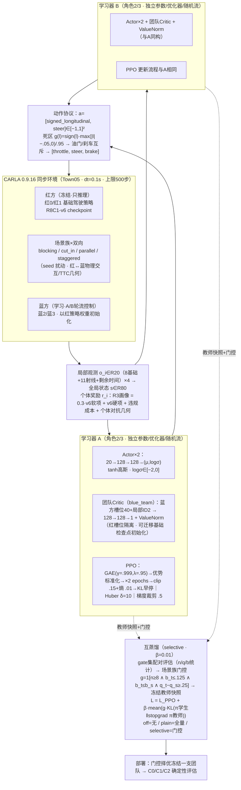

# Mut-MAPPO 算法框架与公式推导

> 面向中期汇报的算法原理文档。范围仅包含**算法框架图与公式推导**，不含实验设计与结果。
> 所有公式、符号与数值均与当前代码实现一致：协议 `mut_mappo_four_car_20_2_v1`，候选配置 `configs/mut_mappo/r3_individual_candidate_v1.json`（R3 个体奖励画像）。
> 整理日期：2026-11-08。

---

## 1. 算法定位

Mut-MAPPO 将作者已发表工作 **Mut-DQN**（IEEE PIMRC 2025，DOI: 10.1109/PIMRC62392.2025.11274845）的互学习（mutual learning）思想迁移到连续动作多智能体策略优化（MAPPO）中。

Mut-DQN 的核心结构是 **多学习器独立探索 + 同一输入上的软知识交换 + 任务目标优先**：

$$L_m = L_{\mathrm{TD},m} + \beta \cdot L_{\mathrm{mut},m}$$

迁移到 MAPPO 时的三处适配：

| Mut-DQN 原文 | Mut-MAPPO 对应调整 |
|---|---|
| 离散 Q 值向量 → softmax 偏好分布的 KL | 连续高斯策略之间的 KL（对角高斯闭式解） |
| 多个学习器各自的 off-policy 经验池 | 各学习器自己的 on-policy rollout，各自 PPO 更新；同伴只提供辅助目标 |
| 固定 β、普遍对齐 | 按场景族的**证据门控**（selective 模式），只在教师更好且足够安全的场景族开启迁移，抑制负迁移 |

**任务设定（研究点一）**：CARLA Town05 中冻结 2 辆红车（基础驾驶策略，R8C1-v6 检查点，只推理不更新），训练 2 辆蓝车学习主动制造**有效且安全**的对抗交互；蓝方由 A、B 两支独立团队学习器轮流采样、互蒸馏，部署时择优冻结一支。

**方法变体与基线**：`method=off`（无互蒸馏）即标准双蓝车 MAPPO；`algorithm=ippo` 为独立学习基线；`method=plain` 为全量互蒸馏，`method=selective` 为门控互蒸馏（本文档描述的主方法）。四种设置共用同一训练栈与总交互预算。

---

## 2. 问题建模

### 2.1 环境与智能体

CARLA 以同步模式运行，`dt=0.1 s`，每步 `world.tick()` 一次，单回合上限 $H=500$ 步。物理实体共 4 辆：

- **红方（冻结）**：红 0 / 红 1，执行预训练基础驾驶策略 $\pi^{\mathrm{red}}$，评估模式、无梯度；
- **蓝方（学习）**：蓝 2 / 蓝 3，策略 $\pi_{\theta_2}, \pi_{\theta_3}$，初始权重从红方检查点复制（迁移起点）。

每回合按案例（case）重置，案例来自四个场景族 `blocking / cut_in / parallel / staggered` 的双向变体，带 seed 扰动。

由于红方冻结，蓝方的学习问题可视为部分可观测随机博弈（POSG）中蓝方的受控视角：全局状态 $s_t\in\mathbb{R}^{80}$、蓝 $i$ 的局部观测 $o_{i,t}\in\mathbb{R}^{20}$、策略动作 $a_{i,t}\in[-1,1]^2$。蓝 $i$ 最大化其带安全约束的个体对抗奖励 $r_i$（第 7.7 节）。

### 2.2 CTDE：集中训练、分散执行

- **Actor** $\pi_{\theta_i}(o_i)$：只输入本车 20 维观测，执行/评估期唯一使用的网络；
- **Critic**（团队价值网络）：仅在训练期使用。当前设计（`critic_scope=blue_team`）只取**蓝方两车自身的观测槽位** $s^{\mathrm{blue}}=[o_2;o_3]\in\mathbb{R}^{40}$ 加 2 类局部角色 one-hot，即 $V_\phi(s^{\mathrm{blue}},j)$，$j\in\{0,1\}$ 为局部蓝 ID；**红方观测槽位不进入 Critic**（前 40 维对预测无影响、对梯度恒为零）。旧的 `all_physical` 作用域（输入全部 80 维 + 4 类 one-hot）保留为历史兼容模式。

IPPO 基线把 Critic 换成只看本角色 20 维槽位的局部 Critic。

### 2.3 双团队学习器（A/B）

A、B 两支学习器拥有**同一组物理角色**（蓝 2/3），但参数、优化器、ValueNorm 与随机数流完全独立。同一时刻环境中只有一辆蓝 2、一辆蓝 3，由当前采样轮次的那支学习器控制；A、B 轮流采集各自 rollout 并各自 PPO 更新。两支学习器共享总交互预算，因此与单学习器基线公平可比；两学习器**不是**两个实验 seed。

---

## 3. 总体框架图

**图 1. Mut-MAPPO 总体框架。** 红方冻结策略与蓝方学习器共存于同一个 CARLA 世界：环境输出 20 维局部观测（拼接为 80 维全局状态）与 R3 个体奖励；A、B 两支学习器轮流采样、各自完成 GAE+PPO 更新；动作经 signed-longitudinal 死区协议映射为 CARLA 的 `[throttle, steer, brake]` 控制；每 `refresh_rounds` 轮在 gate 集上做配对评估、按场景族门控刷新冻结教师快照，向 Actor 损失注入按门控加权的 KL 互蒸馏项；部署时择优冻结一支团队用于 C0/C1/C2 确定性评估。

> 图的可编辑 Mermaid 源码（便于后续修改，渲染于支持 Mermaid 的编辑器/网页）：

---

## 4. 环境接口

### 4.1 局部观测（20 维）

| 维度 | 含义 | 归一化 |
|---|---|---|
| 0–1 | 目标点相对位置 dx, dy | ÷100（米） |
| 2 | 到目标点距离 | ÷100（米） |
| 3 | 目标方位与本车朝向夹角 | ÷π → [−1,1] |
| 4 | 车速 | ÷30（m/s） |
| 5–7 | 当前 throttle / steer / brake | 原生 [0,1]/[−1,1]/[0,1] |
| 8–18 | 11 条射线探测（360° 均匀、默认 4 m，`lidar_range_m` 可配） | 命中距离归一化到 [0,1] |
| 19 | 剩余时间份额 $(H-\mathrm{step})/H$（v4 起显式入状态，避免时间不可辨识） | [0,1] |

整向量做防御性裁剪到 $[-\mathrm{OBS\_CLIP}, \mathrm{OBS\_CLIP}]$（=5.0，正常范围内不触发）。

**全局状态**：按物理 ID 顺序拼接四车观测 $s=[o_0;\,o_1;\,o_2;\,o_3]\in\mathbb{R}^{80}$。已离场车辆槽位置零。

### 4.2 动作协议（signed-longitudinal 死区）

策略输出二维 $a=[l,\ \mathrm{steer}]\in[-1,1]^2$，$l$ 为符号化纵向指令。经奇对称连续死区重缩放：

$$g_d(l)=\mathrm{sign}(l)\cdot\frac{\max(|l|-d,\,0)}{1-d},\qquad d=0.05 \tag{1}$$

$$\mathrm{throttle}=\max(g_d(l),0),\qquad \mathrm{brake}=\max(-g_d(l),0) \tag{2}$$

最终输出 CARLA 的 $[\mathrm{throttle},\,\mathrm{steer},\,\mathrm{brake}]$。性质：中央死区 $|l|\le d$ 输出滑行；油门/刹车**互斥**；死区边界处连续。协议版本 `tanh_gaussian_signed_longitudinal_2d_pre_tanh_z_v2`，映射版本 `signed_longitudinal_deadzone_v2`。

### 4.3 生命周期与数据约定

- **active mask**：已离场车辆观测置零、不再被采样；每步由 `terminated`（真终止：碰撞等）/`truncated`（步数上限截断）两类标志区分。
- **GAE 约定**：只有 `terminated` 切断 value bootstrap；`truncated` 回合末用 $V(s_T)$ 引导（见 6.2）。
- **stall 规则**：低速（<0.2 m/s 持续 3 s）判停，作为任务违规事件进入奖励。

---

## 5. 网络结构

### 5.1 Actor（每个物理角色一个）

$$o \xrightarrow{\ \mathrm{Linear}(20,128)+\mathrm{Tanh}\ } h_1 \xrightarrow{\ \mathrm{Linear}(128,128)+\mathrm{Tanh}\ } h_2 \xrightarrow{\ \mathrm{Linear}(128,2)\ } \mu_\theta(o) \tag{3}$$

$\log\sigma$ 为**可学习参数**（不随状态变化，逐维），经 clamp 限制在 $[\log\sigma_{\min},\log\sigma_{\max}]=[-2,0]$，初始 $-0.5$（初始 $\sigma\approx0.6$，避免 tanh 饱和与早期 approx_kl 爆表；下限保证 $\sigma\ge0.37$，保留持续探索噪声）。

采样：$z\sim\mathcal{N}(\mu_\theta(o),\,\mathrm{diag}(\sigma_\theta^2))$，动作 $a=\tanh(z)$（逐元素）。

### 5.2 团队 Critic（MAPPO）

当前设计为 **blue_team 作用域**（`BlueTeamCritic`，内部即 `AgentConditionedCritic(40,2,hidden)`）：

$$V_\phi(s^{\mathrm{blue}},j)=\mathrm{MLP}\big([s^{\mathrm{blue}};\,\mathrm{onehot}(j)]\big),\qquad s^{\mathrm{blue}}=[o_2;o_3]\in\mathbb{R}^{40},\ j\in\{0,1\} \tag{4}$$

- 实际 MLP 输入 **42 维**（40 蓝方观测 + 2 类局部 one-hot），128–Tanh–128–Tanh–1；物理 ID 2/3 显式映射为局部 ID 0/1；
- 公开的 `state_dim=80`、`num_agents=4` 只是**传输描述符**：rollout、GAE 与 bootstrap 仍走 80 维物理槽位状态，现有 PPO 路径零改动复用（`value_state_dim=40`、`value_id_dim=2` 才是真实网络宽度）；
- **红方槽位严格隔离**：红槽位（前 40 维）扰动不改变预测、梯度恒为零（回归测试 `test_blue_team_critic.py`）；
- 参数在蓝 2/蓝 3 两角色间共享、由局部 one-hot 条件化，同一蓝方观测可为两角色回归不同的价值。

**初始化（`critic_initialization`）**：`random`（默认，随机初始化）或 `base_checkpoint`——权重键与基础两车 Critic（40+2）完全一致，可从红方基础检查点 **strict 加载其 Critic 与 ValueNorm** 继续微调（价值函数热启动；配置校验强制 blue_team 作用域且检查点含 `critic`/`value_normalizer` 键）。

历史兼容：`critic_scope=all_physical` 时使用 `AgentConditionedCritic(80,4,hidden)`（输入 84 维 = 80 全物理槽位 + 4 类 one-hot）。IPPO 基线：每角色独立局部 Critic，只输入本角色 20 维槽位（`LocalObservationCritic` 适配器），配合独立 ValueNorm 与优化器。

### 5.3 ValueNorm

价值目标归一化（官方 MAPPO 的 ValueNorm 路线）：Critic 输出**归一化**价值；rollout 存储、GAE、诊断与公开指标保持原始奖励量纲（用时反归一化）。统计量在每个完整 PPO 更新前、minibatch 之前更新一次。细节见 6.5。

---

## 6. 训练流程

1. **采样**：每轮内 A、B 各采 `episodes_per_team_update=4` 个训练案例（`first_point_complete_pairs_v1` 配对采样或轮转），各自写入独立 RolloutBuffer；
2. **更新**：各自执行一次 PPO 更新（内部 `ppo_epochs=2`，见 6.4–6.5）；
3. **调度**：学习率按进度 $(1-\mathrm{progress})$ 从初值线性衰减到 0.1 倍（horizon 100 轮）；安全成本系数 $\lambda$ 按窗口坏例率以 ×1.2 / ×0.95 在 $[1,10]$ 内调整；
4. **教师刷新**：从第 `warmup_rounds=5` 轮起，每 `refresh_rounds=10` 轮在 gate 集上确定性评估两支学习器，生成配对统计与场景族门控，冻结对方快照作为新教师（见 6.6）；
5. **部署**：训练结束后按门控/选择指标冻结一支团队，用于 C0/C1/C2 确定性评估（本文档不含结果）。

---

## 7. 公式推导

### 7.1 Squashed Gaussian 策略的对数密度与熵

设 $z_j\sim\mathcal{N}(\mu_j,\sigma_j^2)$，$a_j=\tanh(z_j)$。由反函数 $z_j=\mathrm{atanh}(a_j)$ 与 $\mathrm{d}a_j/\mathrm{d}z_j=1-a_j^2=1-\tanh^2(z_j)$，变量替换得

$$\log\pi_\theta(a|o)=\sum_j\Big[\log\mathcal{N}(z_j;\mu_j,\sigma_j)-\log\big(1-\tanh^2(z_j)\big)\Big] \tag{5}$$

数值稳定式（代码 `_log_tanh_jacobian`）：

$$\log(1-\tanh^2 z)=2\big(\log 2-z-\mathrm{softplus}(-2z)\big) \tag{6}$$

**熵**：tanh 前高斯熵有解析式 $H_{\mathrm{pre}}=\sum_j\tfrac{1}{2}\big(1+\log 2\pi\sigma_j^2\big)$；tanh 后无闭式，用重参数化**新采样**的 $-\log\pi_\theta(a|o)$ 估计（必须新采样——用 rollout 旧样本会退化为交叉熵而非 $H[\pi_\theta]$）。

实现细节：rollout 存储 pre-tanh 隐变量 $z$ 而非 $a$，评估用 `evaluate_actions_z` 直接重算对数概率，未更新时 importance ratio 严格为 1（修复 #4）。

### 7.2 广义优势估计（GAE）

对单回合（长度 $T$）定义 TD 残差

$$\delta_t=r_t+\gamma\,V(s_{t+1})\,m_{v,t}-V(s_t),\qquad m_{v,t}=1-\mathrm{terminated}_t \tag{7}$$

优势按 $\gamma\lambda$ 衰减累加：

$$\hat{A}_t=\sum_{l=0}^{T-1-t}(\gamma\lambda)^l\,\delta_{t+l}\cdot\prod_{k=0}^{l-1}m_{\mathrm{trace},t+k},\qquad m_{\mathrm{trace}}=1-\mathrm{done} \tag{8}$$

- **截断回合**（truncated）：回合末用当前 Critic 对 bootstrap 状态前向 + 反归一化得到的 $V(s_T)$ 引导；**真终止**（terminated）用 0。
- **掩码分工**（修复 #2）：$m_v$ 控制 value bootstrap（只有真终止才切断）；$m_{\mathrm{trace}}$ 控制 trace 在回合边界切断。
- **解释**：$\lambda=0$ 退化为 1 步 TD（低方差、高偏差），$\lambda=1$ 退化为 Monte-Carlo 型估计（无偏、高方差），$\gamma\lambda$ 控制偏差–方差折中。当前 $\lambda=0.95$，$\gamma=0.999$。

回报目标为优势与旧价值之和（代码显式校验）：

$$\hat{R}_t=\hat{A}_t+V(s_t) \tag{9}$$

### 7.3 优势标准化

每个 agent 在其**整段 rollout** 上做一次标准化（跨 episode 合并，而非逐 episode）：

$$\hat{A}\leftarrow\frac{\hat{A}-\mathrm{mean}(\hat{A})}{\mathrm{std}(\hat{A})} \tag{10}$$

退化批次（样本数 <2 或 $\mathrm{std}\le10^{-6}$）保持不变，避免把有效信号替换成噪声放大。

### 7.4 PPO 裁剪目标

$$r_t(\theta)=\exp\!\big(\log\pi_\theta(a_t|o_t)-\log\pi_{\mathrm{old}}(a_t|o_t)\big) \tag{11}$$

$$L_{\mathrm{surr}}=-\mathbb{E}_t\Big[\min\big(r_t\hat{A}_t,\ \mathrm{clip}(r_t,1-\epsilon,1+\epsilon)\,\hat{A}_t\big)\Big],\qquad \epsilon=0.15 \tag{12}$$

$$L_{\mathrm{actor}}=L_{\mathrm{surr}}-c_e\,\bar{H}_{\mathrm{post}},\qquad c_e=0.01 \tag{13}$$

**KL 早停**：近似 KL 用 Joschu 估计式 $\mathrm{approx\_kl}=\mathbb{E}[r-1-\log r]$；某 agent 的 epoch 均值超过 $1.5\times\mathrm{target\_kl}=0.03$ 时，后续 epoch 不再更新该 agent（逐 agent 独立判断）。梯度裁剪 `max_norm=0.5`；Adam 学习率 $3\times10^{-4}$（线性衰减至 0.1 倍）；`ppo_epochs=2`，minibatch=128。

### 7.5 Critic、ValueNorm 与 Huber 损失

ValueNorm 指数滑动矩（$\beta_{\mathrm{vn}}=0.99999$，去偏，方差下限 $10^{-2}$）：

$$\mu\leftarrow\beta\mu+(1-\beta)\,\mathbb{E}[\hat{R}],\qquad \overline{\sigma^2}\leftarrow\beta\,\overline{\sigma^2}+(1-\beta)\,\mathbb{E}[\hat{R}^2],\qquad \hat\sigma^2=\max\!\Big(\frac{\overline{\sigma^2}-\mu^2}{1-\beta^{t+1}},\,10^{-2}\Big) \tag{14}$$

Critic 输出归一化价值 $\hat{V}$，回归目标为归一化回报：

$$L_V=\mathbb{E}\Big[\mathrm{Huber}_\delta\big(\hat{V}-(\hat{R}-\mu)/\hat\sigma\big)\Big],\qquad
\mathrm{Huber}_\delta(e)=\begin{cases}\tfrac12 e^2,&|e|\le\delta\\ \delta(|e|-\tfrac12\delta),&|e|>\delta\end{cases},\quad \delta=10 \tag{15}$$

诊断指标（反归一化到奖励量纲后）：$\mathrm{EV}=1-\dfrac{\mathrm{Var}(\hat{R}-V)}{\mathrm{Var}(\hat{R})}$。

### 7.6 互蒸馏：KL 闭式与证据门控

两个对角高斯之间的 KL（逐动作维求和）：

$$\mathrm{KL}\big(\mathcal{N}(\mu,\sigma^2)\,\big\|\,\mathcal{N}(\tilde\mu,\tilde\sigma^2)\big)
=\log\frac{\tilde\sigma}{\sigma}+\frac{\sigma^2+(\mu-\tilde\mu)^2}{2\tilde\sigma^2}-\frac12 \tag{16}$$

辅助损失（加到 $L_{\mathrm{actor}}$ 上，教师侧 `stopgrad` + `no_grad` + `eval()`）：

$$L_{\mathrm{mut}}=\beta\cdot\mathbb{E}_{\mathrm{rows}}\Big[g_{\mathrm{row}}\cdot\sum_j\mathrm{KL}\big(\pi_{\theta,j}\,\big\|\,\mathrm{stopgrad}(\pi_{\mathrm{teacher},j})\big)\Big],\qquad \beta=0.01 \tag{17}$$

- **方向**：默认 `student_to_teacher`（学生在前，即式 (16) 的前向 KL，与 Mut-DQN 原文一致）；另有 `teacher_to_student`（反向）与 `symmetric` 变体。
- **reduction=all_valid**：零门控行仍计入分母，保证跨配置可比。
- **锚定项**（可选）：$L_{\mathrm{anchor}}=\beta_{\mathrm{anchor}}\mathrm{KL}(\pi_\theta\|\pi_{\mathrm{init}})$，当前 R3 配置 $\beta_{\mathrm{anchor}}=0$。

**证据门控**（evidence 变体）。每 `refresh_rounds` 轮在 gate 集上确定性评估 A、B，对每个场景族 $f$ 记录配对统计：$n$=有效案例数、$q$=合格响应率（`blue_eligible` 且产生响应）、$b$=违规率（`blue_eligible` 为假）。学生 $s$ 向教师 $t$ 蒸馏的门控为：

$$g_f(s\!\leftarrow\!t)=\mathbf{1}\big[n_s\ge n_{\min}\ \wedge\ n_t\ge n_{\min}\ \wedge\ b_t\le b_{\max}\ \wedge\ b_t\le b_s\ \wedge\ q_t-q_s\ge q_{\min}\big] \tag{18}$$

$n_{\min}=8$（`gate_min_cases`），$b_{\max}=0.125$（`gate_max_bad_rate`），$q_{\min}=0.25$（`gate_min_q_gap`）。

语义：教师样本足够、教师安全达标、且教师合格率**显著高于**学生时，才在该场景族开启蒸馏——即"好老师、够证据、才有迁移"。**对照变体**：`random`（同数量的随机行，与证据无关）、`strength`（所有行按证据比例加权），用于机制归因诊断；默认 `evidence`。

### 7.7 奖励函数

#### R3 个体画像（当前主线，`individual_driving_critical_v3`）

对每个活跃蓝车 $i$：

$$r_i=\alpha\,S_i+H_i-c_{\mathrm{task}}\cdot\mathbf{1}[\text{首次任务违规}_i]+\beta_{\mathrm{adv}}\big(C_i+E_i+G_i\big) \tag{19}$$

$\alpha=0.3$（`base_soft_weight`），$\beta_{\mathrm{adv}}=1.0$（`adversarial_weight`）。各项含义：

- **$S_i$：v6 软项之和**（progress、success、timeout、lane、pace、proximity、smoothness），整体乘 $\alpha$ 降权——保留基础驾驶能力但不让其主导对抗目标；
- **$H_i$：v6 硬项之和**（collision、offroad、road_rule），带符号原值、**不缩放**——安全底线；
- **$c_{\mathrm{task}}=20$**：任务违规（stall 判停）首次一次性成本；
- **个体对抗几何**（每蓝独立跟踪器，只与两红比较）：
  - $C_i=w_{\mathrm{crit}}\cdot\Delta e_i/\mathrm{cap}$：暴露积分增量 $\Delta e_i=\min(\mathrm{cap}-e_i,\ dt\cdot q)$，**暴露上限 cap=2 s**、$w_{\mathrm{crit}}=3.0$，即单回合临界信用上限 3.0；$q$ 为带宽指示：TTC 落入 $(0.5\,\mathrm{s},\,1.5\,\mathrm{s}]$ 且当步合格（蓝无违规、合法前进、纵向位于红车前方、红未达、无 severe 事件）时取 1，否则 0；
  - $E_i=5.0$：**主事件一次性奖励**——credit 宽限 1 s 之后，同一红蓝对 TTC $\in(0.5,1.5]$ s 连续 $\ge0.3$ s 且当步合格时支付；事件支付即时、事后失败不追回（与 R2 时序一致）；
  - $G_i=-w_{\mathrm{sev}}\cdot dt\cdot\mathbf{1}[\min\mathrm{TTC}\le0.5\,\mathrm{s}]$，$w_{\mathrm{sev}}=2.0$：严重逼近的持续负塑形，且当步**压制**全部正信用（$q=0$）；
- **TTC 协议**（`critical_interactions_v1`）：2D OBB、固定 yaw 匀速、5 s 预测窗，分离轴求首次接触时刻；每 tick 多车对只取最小 TTC；TET/TIT 为 1.5 s 阈值下的事件积分；缺失几何记 MISSING，不视为零危险。
- **预算校验**：正奖励总量必须小于最小安全成本×$\gamma^{H-1}$（$\min\{50,50,50,20\}\times0.999^{499}$），从配置层面防止对抗收益压过安全成本。
- 团队上报分量 = 两蓝个体分量按 2 平均（仅报告用；团队级几何指标仍独立测量，不分配给 actor）。

#### C1 团队效率画像（`c1_progress_team_v1`，团队奖励路线，附）

$$a_t=\frac{1}{2H}\sum_{r\in\{0,1\}}\big(\mathrm{ref}_r(t)-p_r(t)\big) \tag{20}$$

参照曲线 $\mathrm{ref}_r(t)$ 为红车在无对抗参照运行中的标准化进度（C1 参照目录按身份哈希校验）；两红全部到达后按吸收尾项继续计入（折扣后一次性折叠进最后一个真实动作，`settle_team_tail`）。

$$d_t=\tfrac12\sum_{b\in\{2,3\}}\big(\gamma\,p_b(t)-p_b(t-1)\big)\qquad\text{（势能型塑形，Ng et al. 1999）} \tag{21}$$

$$u_t=10\,a_t+10\,\mathrm{tail}_t+1\,d_t-\mathrm{risk}_t-\mathrm{comfort}_t-\mathrm{events}_t \tag{22}$$

risk=超速/雷达/TTC 成本均值；comfort=纵向/转向变化率；events=首次碰撞/越界/违规一次性成本（50/50/50/20）。注意：pace 类成本**不声称势能不变性**（文档明确声明为有代价干预）；`driving` 项为势能型。

---

## 8. 超参数总表（R3 候选配置）

| 分组 | 参数 | 取值 |
|---|---|---|
| 环境 | timestep / max_steps / town | 0.1 s / 500 / Town05 |
| | stall 规则 | <0.2 m/s 持续 3 s |
| 模型 | obs / action / state 维度 | 20 / 2 / 80（4×20，传输格式） |
| | hidden / 激活 | 128 / Tanh×2 |
| | logσ 初始 / 范围 | −0.5 / [−2, 0] |
| | critic_scope | `blue_team`（当前设计，输入 40+2）/ `all_physical`（历史兼容，输入 80+4） |
| | critic_initialization | `random`（默认）/ `base_checkpoint`（strict 迁移基础 Critic + ValueNorm） |
| 学习 | γ / GAE λ | 0.999 / 0.95 |
| | clip ε / ent_coef / target_kl | 0.15 / 0.01 / 0.02（早停 1.5×） |
| | ppo_epochs / minibatch | 2 / 128 |
| | lr_actor = lr_critic（线性衰减至 0.1×，horizon 100 轮） | 3×10⁻⁴ |
| | 梯度裁剪 max_norm | 0.5 |
| | ValueNorm β / 方差下限 / Huber δ | 0.99999 / 10⁻² / 10 |
| 互蒸馏 | β / anchor_β / 方向 | 0.01 / 0.0 / student_to_teacher |
| | warmup / refresh 轮数 | 5 / 10 |
| | 门控 n_min / b_max / q_min | 8 / 0.125 / 0.25 |
| R3 奖励 | base_soft_weight α / adversarial_weight | 0.3 / 1.0 |
| | critical_weight / 暴露上限 | 3.0 / 2 s |
| | primary_event_reward / 事件带 (severe, event] / 持续 | 5.0 / (0.5 s, 1.5 s] / ≥0.3 s |
| | credit 宽限 / severe 权重 / task_violation_cost | 1 s / 2.0 / 20 |
| 运行 | episodes_per_team_update | 4 |
| | 成本系数 λ：目标坏例率 / ×up / ×down / 范围 | 0.05 / 1.2 / 0.95 / [1,10] |
| | seed | 42（A/B 团队分别 +1000/+2000） |

> 注：`rounds=2`、`train_tick_budget=12000` 为本地候选模板值（`r3_individual_candidate_v1.json` 明确标注非服务器长训配置）；该候选配置尚未写入 `critic_scope`/`critic_initialization` 键，按代码默认值（`all_physical`/`random`）生效——采用新团队 Critic 设计的运行需在 `learning` 中显式声明 `critic_scope: "blue_team"`（及可选的 `critic_initialization: "base_checkpoint"`）。

---

## 9. 代码索引

| 文件 | 职责 |
|---|---|
| `environment/mut_mappo_env.py` | 四车环境：案例重置、active 生命周期、R3/团队奖励分派、全局状态 |
| `environment/mut_mappo_critical_reward_v3.py` | R3 个体画像：v6 基础项 + 逐蓝几何信用 |
| `environment/mut_mappo_critical_reward_v2.py` / `_v1.py` | 正常驾驶临界团队奖励 / TTC 暴露-事件-严重几何 |
| `environment/mut_mappo_efficiency_reward.py` | C1 团队效率奖励（参照曲线 attack）与尾部结算 |
| `environment/base_reward_v6.py` / `_v5.py` | 红方基础奖励 v6/v5 分量（软/硬项来源） |
| `training/mut_mappo_learning.py` | `TeamLearner`：A/B 团队、门控状态、PPO 入口与蒸馏 hook |
| `training/mutual_distillation.py` | 高斯策略 KL、门控变体（evidence/random/strength） |
| `training/train_mut_mappo.py` | 串行训练主循环：采样、更新、教师刷新、检查点 |
| `training/train_no_rllib_mappo_robust_v2.py` | 共享 PPO 核心：RolloutBuffer、GAE、优势标准化、PPO 更新 |
| `training/mut_mappo_config.py` | 配置校验、任务合同摘要、模型规格 |
| `training/value_normalization.py` | ValueNorm 与归一化 Huber 损失 |
| `training/action_protocol.py` | signed-longitudinal 死区协议 |
| `models/actor_critic.py` | Actor（tanh 高斯）、AgentConditionedCritic |
| `models/blue_team_critic.py` | 蓝方团队 Critic（40+2：蓝槽位 + 局部 ID，权重键兼容基础检查点） |
| `models/mut_mappo_critics.py` | IPPO 局部 Critic 适配器 |
