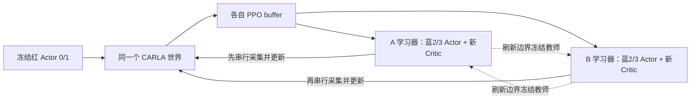

# 四车对抗审查与 B0 先导候选计划（2026-10-28）

> 执行方式：本对话在用户明确启动后按阶段串行执行。本文不是运行授权。配置准备不授予弱红豁免或正式实验资格。

**Goal:** 先确认 u1000 在拟用四车任务中能否提供可解释的普通交通基线，再用单外层 seed、小预算 B0 检查学习闭环与安全合格效率信号。

**Architecture:** 复用公共 20/2 Mut-MAPPO、C1 参考团队奖励、完整 A+B 边界恢复与冻结评估。仅新增本目录的配置、审查记录及一个调用现有评估 API 的训练初态预检入口，不修改原算法或历史证据。

**Tech Stack:** CARLA 0.9.16 / Town05 / 0.1s，根目录 venv，PyTorch CPU，现有 MAPPO PPO/GAE/ValueNorm。

## 结论与路线

当前仅适合完成离线准备，并在后续获准启动后进入 **L1：C0/C1 真实工程诊断**。现在不应开始正式 B0/B1/B2 比较。u1000 是已统一冻结节点中验证到达率最高的候选，仍为 NOT_QUALIFIED；它不是正式合格红方，也不是全部保存模型的全局最优。

三条路线的区别：

| 路线 | 当前建议 | 能回答 / 不能回答 |
|---|---|---|
| L1：只做 C0/C1，暂不学习 | 下一步优先 | 检验四车出生、普通交通、初态复现和观测/事件/成本记录；不能证明攻击效果 |
| L2：明确授权的弱红 B0 诊断 | L1 之后条件性候选 | 检验 PPO、回报信用、恢复和相对弱基线的效率变化；不能支持合格红方上的算法优势、泛化或安全保证 |
| L3：合格红方上的正式算法比较 | 当前不具备 | 需要合格红方及四车证据、独立外层 seeds、共同冻结预算/协议；本对话不恢复基础训练 |

没有设置 `--allow-weak-red`，也没有放松任何已有驾驶阈值。即使 L1 的到达率检查通过，基础资格仍不自动改变。后续若用户只说“启动 C0/C1”，只执行 L1；若希望 L2，必须明确选择弱红诊断范围。

## 实际基础证据

固定候选为 `diagnostics/base_driving_vnext_20261020/long_s42_u600_v1/u001000.pt`，SHA256：

`0ac714a5172621cb1b716604bd69dd3a32dfaa57d5e44678eae7815195d6981a`

u1200 对照 SHA256：`e6b1f93b770e2bb6cf7b40d3cba33b50bbc16e46ea4da2b4023f283498736163`。两者实际文件重新计算匹配。唯一基础 run 为 `logs/BD_vNext_V6_scratch_s42_u600_20261020_v1`。

| 节点 | 并排共同到达 | 错位共同到达 | 基础资格 / selection |
|---|---:|---:|---|
| u400 | 32/32 | 42/64 | NOT_QUALIFIED / NO_QUALIFIED_CANDIDATE |
| u600 | 32/32 | 44/64 | 同上 |
| u800 | 32/32 | 54/64 | 同上 |
| u1000 | 32/32 | 62/64 | 同上 |
| u1200 | 32/32 | 60/64 | 同上 |

u400/u600 使用 `reevaluation_u400_u600_20261027_v1` 中的统一复评；不将旧版本资格混入同表。u1000→u1200 按 scenario+seed 配对：60 例持续成功、2 例成功转失败、2 例持续失败、0 新增成功。u1000 错位验证碰撞/越界/道路违规分别 0/0/2；u1200 为 0/0/4。

u1200 的每车巡航、上限速度检查各 64 例未过；参考车道稳定性 A0/A1 为 64/52，实际转向稳定性为 58/58。这些检查重叠，不能相加当失败回合数。A1 案例 P95 横向偏差均值约从 0.808m 升到 1.021m。速度标准是本研究任务偏好，不能称道路法定限速；现有两 seed、Town05 走廊也不能称正式 heldout 或跨地图证据。

u801–1000 / u1001–1200 各 3,200 个提交回合：共同到达 87.59%/91.44%，碰撞 2.31%/2.38%，越界 4.78%/3.41%，道路违规 4.69%/2.50%。这两个200-update窗口的 Critic MAE均值约 3.120/2.558，目标标准差均值7.050/5.859，联合EV均值0.218/0.168；这些不是u1000/u1200单节点值。单节点MAE约3.269/2.217、EV约0.162/0.070，不能据任一口径宣布收敛。

u1200 已提交 1,200 updates、19,200 回合。`session/launch.json` 的 UUID 与 `exit.json` 一致，实际 worker PID=1716，returncode=0；不把包装器 PID 当训练器。累计 ratio、奖励残差、非有限数和跳过更新检查均为零。重新核算数据及证据 SHA 见 `checks/offline_audit.json`；这是读取历史证据，不是本轮重跑基础评估。

## 已有实现与待验证边界

| 环节 | 当前源码事实 | 仍缺的证据 / 动作 |
|---|---|---|
| checkpoint/角色 | u1000/u1200 可严格加载 20/2；红0/1冻结；蓝2←源0、蓝3←源1 | 严格加载不代表四车驾驶合格 |
| MAPPO | 每个 A/B 各两个 Actor、新 80+4 维 Critic、新 ValueNorm/优化器/RNG | 需要真实四车 PPO 保存—退出—恢复—独立评估 |
| 奖励与生命周期 | C1 进度团队奖励、出生保护、团队安全事件去重、退场尾项已实现 | 真实奖励量级、退出后尾项、持续反馈和安全事件需逐轨迹核验 |
| 互学习 | B0 off / B1 plain / B2 selective 实际切换；冻结教师、同角色 KL、all-valid 分母 | B2 门控是否有足够支持、是否全关，需要真实独立 gate；本轮不跑 B1/B2 |
| 场景 | 现有生成器训练24、gate/selection/test各16；本地 OpenDRIVE 可检验72例几何 | 实际出生、初速、清理、四车终止与传感器时序未由本轮验证 |
| C0/C1/C2 | 配对评估、环境故障整组重试、selection安全筛选、冻结导出与test已有 | 原默认 red-eval 只覆盖 gate 11m；还需训练10m初态预检 |
| 贡献解释 | 四车保持不变的00/10/01/11及负贡献、交互项均已有 | 按四组均安全子集解释；不等于精确状态/动作反事实 |
| 监控与所有权 | `CarlaOwner` 全机进程检查+端口锁、idle world预检；`inspect`纯文件 | 锁不能约束不合作的其他客户端；启动时仍须核对全机控制器。当前没有检查服务器状态 |

旧《对抗训练前评估…20261026》把团队奖励、尾项和四组合标成“未实现”，已被当前源码及同日运行说明更新；本审查不改旧文档。

需要明确的执行缺口：

1. `run_first_point_experiments run` 检查基础资格及 C0/C1，独立 `train` 子命令不重检；`candidate` 或 `--allow-candidate` 也不等于弱红授权。因此不能用分段命令绕过本计划资格边界。
2. 评估 API 支持 `split=train`，其 CLI 的 choices 未暴露 train。本目录 `screen_train.py` 只是调用原 API，默认离线，只有显式 `--execute` 才运行真实 C0/C1。
3. `mut_mappo_reference.prepare` 和四组合入口未接入覆盖 runtime 初始化/清理的完整成本 callback；已有每案例 tick 计数不是所有成本。学习阶段前应补接现成 audit callback，或明确将未测量部分记为 unknown/下界。不能宣称已满足全程精确总成本审计。主训练 `actual_cost_audit.jsonl` 与标准 C0/C1/C2 evaluator 已有完整 callback。
4. 记录中明示 collision callback frame barrier=`not_enforced`、live validation=`pending`。先验证碰撞对象/帧、终止时序和迟到事件，不能从离线事件测试推导真实无碰撞保证。
5. 参考身份绑定 red、案例清单与 task；没有单独纳入被引用 base_scenario 内容 SHA。训练身份有 scenario_hashes。阶段开始必须用本目录的 scenario/source 清单重验，改场景/源码则新版本，不复用旧曲线。
6. `blue_eligible` 表示本合同下无蓝方碰撞/越界/道路事件/驻停违约，不是完整驾驶资格；超速是软成本，红方任务结束时蓝方未到达不自动算违约。仍需分报蓝方完成、速度、车道及控制指标。
7. 当前效率排名的 `safe_efficiency_utility` 用 C2 蓝资格掩码；成功率差的 `AttackGain_safe` 才同时要求 C1/C2 合格。弱红诊断必须补报双方均合格的效率贡献（以所有共同有效案例为分母），不能只引用 C2 的 safe 标签。
8. Mut session supervisor目前记录Popen.pid；Windows venv可能另有实际Python worker。真实启动时必须额外核验实际worker及父子关系，保留UUID、命令行、边界增长与退出的关联，不能照搬基础run的actual_worker_pid已验证结论。
9. u1000基础任务时限400步，本计划沿用现有四车案例500步。20维中的剩余时间归一化因此改变，虽可严格加载，也不是相同任务分布；这正是必须重新做四车C0/C1的原因之一。源码从checkpoint继承lidar_range_m=20、ttc_max_range_m=20，不使用旧文档的默认探测范围。若改回400步，必须同时更新案例时限与任务身份，另建版本。

## 训练原理与实际奖励

每车观测20维：8个目标/速度/控制特征 + 11条归一化雷达距离 + 1个剩余任务时间。策略输出 `[signed_longitudinal, steer]` 两维，经 tanh 与统一映射变成 CARLA 的 `[throttle, steer, brake]` 三通道，纵向 deadzone=0.05；物理控制三通道不表示策略动作是3维。

Actor 是两层128宽 Tanh MLP，高斯均值头及可学习 log_std。红0/1始终使用确定性冻结 Actor。蓝方按随机策略采集自己的轨迹；训练使用原 PPO clipped objective、GAE、ValueNorm、梯度裁剪、ratio/有限值检查与 KL 停止，未复制另一套 PPO。

图中 A/B 的 buffer 始终独立，箭头不表示交换 on-policy 轨迹。每轮各4个完整回合、各更新一次；下轮交换先采顺序。四车20维观测拼接成80维，Critic 再加4维物理ID one-hot，只拟合蓝2/3回报。基础双车 Critic、ValueNorm、优化器不迁入，也不需要等待基础 Critic “完全收敛”才研究冻结红方。

令 `N=500`、`dt=0.1s`，统一名义时域50s。红车完成度 `p_r(t)` 为沿实际起始道路方向到目标的归一化投影，已到达记1。C1使用同一 u1000 的普通冻结蓝2/3，每个模板预先记录 `p_ref,r(t)`。

`a_t = I(出生保护已结束且蓝仍合格) * sum_r(p_ref,r(t)-p_r(t))/(2*N)`

主训练奖励为：

`G_t = 10*a_t + mean_b(gamma*p_b(t)-p_b(t-1)) - risk_t - comfort_t - event_cost_t`

- 红更快时 a 为负；持续落后会持续计入，不受旧2秒滑窗遗忘。出生前3秒不给攻击项。蓝方一旦违约，后续正攻击信用关闭，最终安全效率效用也按整回合资格清零。
- risk 含每蓝 `0.005*max(speed-4.1667,0)^2`、lidar和TTC成本，再取两蓝平均；这是当前0.1s离散步口径，不宣称所有成本已统一成每秒系数。
- comfort 来自冻结基础 reward 的纵向控制变化和转向变化负项。蓝方进度权重1，不再单独继承大额到达奖。
- 每回合每类别首次团队事件：碰撞50、越界50、道路违规50、驻停任务违约20；同类别不因持续标志/两传感器重复扣。风险仍逐步累计，事件成本也不是硬安全保证或法律责任判定。
- 旧减速+5、距离威胁和关联超时+15仍能输出诊断，但被新 profile 替换，不进入实际蓝方 PPO reward。新 profile 的 lambda 固定为1；旧4回合安全率乘法调度不生效。
- 红方全部完成时，已知“完成吸收状态”的参考尾项以 gamma 折算结算；事故/外部截断不伪造未来物理帧或50秒失败收益。
- 蓝车先退场则停止采动作；其后真实团队 reward 的折扣尾和加到最后一个真实动作，不生成失活动作。日志 `returns`、`team_discounted_return` 与 `team_tail_credit`含义不同。

共享 G 仍通过各 Actor 自己的 log_prob 与优势更新，不代表两个蓝车采取相同动作，也不等于已经识别了因果贡献。短路线、3秒保护和50秒归一化可能使攻击项很小，必须查看各 reward component 和安全合格效率，不以总 reward 增长代替攻击成功。

Mut 实现是此项目对连续随机策略的互蒸馏适配：

`L_actor = L_PPO + beta * mean_all_valid[g(family)*KL(N_student || N_frozen_peer)] + anchor_beta*KL_anchor`

默认 beta=0.01、anchor_beta=0。教师在学生自己的同角色观测上重算高斯分布、无梯度；KL 在 tanh 前计算，不将 deadzone 后物理控制分布 KL 混称此指标。零gate行仍保留在分母中。

| 组 | 实际差异 |
|---|---|
| B0 | 双独立 MAPPO，method=off；仍执行共同 gate 开销，互蒸馏损失关闭 |
| B1 | 两蓝团队同角色普通互蒸馏，刷新后各族gate视为1 |
| B2 | 每族 gate：教师/学生各至少8例，教师坏率≤1/8且≤学生，安全效率均值比学生高≥0.02才启用 |

教师按A+B实际训练ticks在≥10,000的完整边界首次刷新，之后距实际刷新点再增加20,000 ticks；A/B教师同步冻结到下一刷新。本先导只跑B0。B2全关是可报告结果，不为开门改阈值。该V(s,id)不是联合动作Q，不是COMA，也无约束策略优化的安全保证。

四组合解释复用现成模块：0=普通蓝，1=学习蓝。`phi2=.5*((U10-U00)+(U11-U01))`，`phi3=.5*((U01-U00)+(U11-U10))`，`I=U11-U10-U01+U00`。这里 U 为相同冻结团队效用，不用各组 Critic 或动态lambda排名；保留负贡献，并同时报告四组均合格子集。I>0才支持该定义下的超加性；不用于首轮在线训练。

## 候选执行预算与顺序

本目录仅登记 B0_s42；u1200只保留对照身份，不在本先导自动追加运行。默认CPU、关闭相机和spectator更新、无通信。若改为CUDA，应在开始前建立新配置版本，不能中途改同一实验身份。

| 阶段 | 固定案例与回合 | 出口 |
|---|---|---|
| L1训练初态 C0/C1 | train24×2=48 episode；蓝在对应红前方10m | 核验全部拟训练初态与自然失败 |
| L1 gate初态 C0/C1 | gate16×2=32 episode；蓝前方11m | 与现有red_readiness口径对照，分parallel/staggered/方向/编号对 |
| L2普通参考，须先获准弱红范围 | train24+gate16+selection16，各2次C1，共112 episode | 固定seed与seed+10000；两曲线平均、逐参考资格、噪声范围；不读test |
| B0首完整轮 | A4+B4=8 episode，计入总预算 | 保存、正常退出、同身份恢复，验证非有限数、角色、尾项和已提交边界 |
| B0恢复到共同预算 | A+B合计24,000实际训练world ticks，含训练初始化/reset/cleanup与废弃采样 | 完整A+B边界软上限；不以updates或两队各24k替代 |
| 共同gate刷新 | 每次A/B各16，共32 episode；本预算正常预计1次 | 独立gate数据与教师hash匹配；不更新PPO |
| 仅最终边界 selection | A/B×16×(C1+C2)=64 episode | 全部共同有效；先b≤1/8筛选，再效率、AttackGain_safe、q等排序；最多导出1队 |
| 冻结后test参考 | test16×2 C1=32 episode | 仅在selection冻结后生成，不用于训练或选模 |
| 冻结test | 1队×16×(C0+C1+C2)=48 episode | 只报预先规定的最终边界，不按test挑轮次/追加预算 |
| 可选后续贡献诊断 | 1队×16×4=64 episode | 不含在首轮必做预算；另行决定 |

沿用现有生成器：训练滚动四方向、并排及±8m错位、完整Actor编号对；gate/selection/test各8例parallel+8例staggered，错位幅度来自±4m验证来源，并以11/12/13m蓝红间距区分四车几何。它们仍共享Town05走廊；物理初态留出不等于独立地图分布。A/B不是两个实验seed。案例键、物理初态和split完整性由现有校验器检查。

L1参考现有readiness阈值为 C0/C1红共同到达率≥95%、C1蓝资格率≥95%、无invalid；16例gate意味着各项16/16。训练24例应完整报告24例及逐层结果，不能借通过率遮盖自然事故或筛掉坏模板。基础资格失败始终保留；普通C1仍明显失控或噪声过大时先停止，报告能力缺口，不自动转学习。

工程成功：真实出生/初速与配对证据完整；冻结红hash未变；奖励分解有限且一致；退出及活动mask正确；无假动作；首轮保存—正常退出—恢复；按实际ticks停止，失效与废弃成本不丢失。selection若没有合格蓝队，保留NONE_QUALIFIED，不自动导出。

值得扩大先导的信号：在双方蓝均合格的配对案例中，红方相对C1的效率下降为正，parallel/staggered分层方向一致，且明显超过两次普通C1参考的差异；结合成功率转坏/转好、双成功到达延迟和全部结局判断。当前样本只用于工程决策，不声称统计显著性、收敛或算法优势。无信号或主要收益来自蓝违约，同样是有效诊断结果；结束本预算后共同决定下一新版本，不单独给某组加预算。

## 指标、失败处理与成本

所有 C1/C2 使用同案例、红checkpoint、初态及paired seed；C0用于识别自然失败。保留实际出生位置/速度/道路lane/传感器帧；当前源码仅有出生位置漂移≤1m检查，不能据此宣称各条件实际初速或逐帧完全一致。发现系统性配对偏差先停查。

`AttackGain_raw = mean(S_C1-S_C2)`

`AttackGain_safe = sum((S_C1-S_C2)*eligible_C1*eligible_C2)/N_common`

同时报raw-safe、转坏/转好/持续失败、蓝四类违约、红安全事件、完成度差、仅双方成功的延迟及样本数。效率代理另报有符号进度差与C1/C2均合格贡献，分母保留全部共同有效案例。红自然失败、普通交通延迟不算攻击成果；蓝违规收益单列。不得把缺失TTC当0风险，也不能只在成功子集报时间而隐去失败。

环境故障/人工停止/预算截断不是任务失败。标准 evaluator 每组最多1次重试，重跑整组同案例同seed，保留失败尝试与成本；仍不完整则停止选模。真实红失败为有效任务失败，另一红可能被外部截断，不把两车都记同一自然失败。训练只从manifest指向且SHA匹配的完整A+B边界恢复；A已更新B中断的部分不登记安全轮，废弃ticks继续消耗24k预算。禁止自动kill、重启、改阈值、换红或复用改动后的身份。

按一次gate、无重试估算：非训练共368 episode，每回合最多500 decision ticks，共≤184,000 decision ticks；加24,000训练ticks及完整边界超额、评估setup/cleanup。可选贡献另64回合、≤32,000 decision ticks。训练软超额至多下一个完整8回合边界的实际成本：≤4,000 decision ticks+该轮setup；不能直接宣称28k是完整world ticks硬上限。

这只是保守任务上界，不是墙钟承诺。若368回合平均80–150 decision ticks，则非训练约29,440–55,200 decision ticks（尚未实测），再加训练24k、所有setup及重试。先用L1实测各阶段 `actual_world_ticks / elapsed_seconds`，墙钟按 `ticks/吞吐 + PPO/IO时间`更新；例如仅24k训练，在5/10 ticks/s时约80/40分钟，评估另算。两红基础评估吞吐不能直接套四车。

初始化/清理计数须修补上表所列reference/credit缺口后才可给精确全程total；补齐前报已测下界及unknown，不用决策步冒充真实总world ticks。训练close后的最终audit优先于较早写出的session/status快照。重试、废弃采样、验证成本分列，A+B预算只算一次。

## 计划检查点与正式比较前缺证

- [x] 阅读AGENTS与三份指定文档，对照当前入口、reward、gate、checkpoint和selection源码。
- [x] 核验固定checkpoint SHA及CPU角色加载，建立新目录，保留NOT_QUALIFIED与未授权状态。
- [x] 配置train24/gate16/selection16/test16，B0外层seed42、24k实际训练ticks；准备离线检查及原有测试入口。
- [ ] 用户明确启动L1；核验当前服务器版本、Town05、全机所有者和idle world，再串行80例C0/C1。
- [ ] 真实检查sensor回调、出生/初速配对、终止/清理与普通蓝行为；补齐reference成本callback。
- [ ] 如用户明确授权弱红诊断，冻结两次C1参考和噪声证据，执行B0首轮/恢复/最终冻结评估。
- [ ] 真实四车工程闭环完成且安全合格效率信号可解释，才讨论B1/B2小比较；它仍是弱红诊断比较。
- [ ] 正式比较另外需要合格正常红方（冻结SHA+完整基础逐车/分层资格）、拟用四车C0/C1与live几何证据、稳定普通蓝、共同冻结奖励/时域/预算/选模机会、建议至少3个独立outer seeds及不确定性；不能用A/B或大量episode代替独立训练重复。

正式B0/B1/B2各组固定红、奖励、case split、总训练ticks、教师/gate时点与selection候选数量。B2若有积极信号，再考虑现有等覆盖随机gate/等强度控制，区分选择质量与蒸馏强度；不在首轮引入通信、PSRO、新信用网络。已有普通MAPPO/IPPO入口可用于后续算法基线，本轮不额外跑。

仅在获准的长段实际启动后创建该新run的20分钟heartbeat：纯文件读取manifest/SHA、最后提交metrics、actual cost、status、launch/exit UUID及worker、错误日志。正常推进保持安静，只通知异常、重要结论、完成或需用户处理；绝不tick/reset/spawn/load_world，不自动重启。完成后删除该监控。旧carla-u1200监控不恢复，本轮也不创建新监控。

具体模块命令见同目录 `commands.md`。本目录 `experiment.json` 的授权字段只是可审查记录，原始训练API不会强制它；因此后续执行者必须遵守上述阶段边界，不能以有配置为由直接启动。
